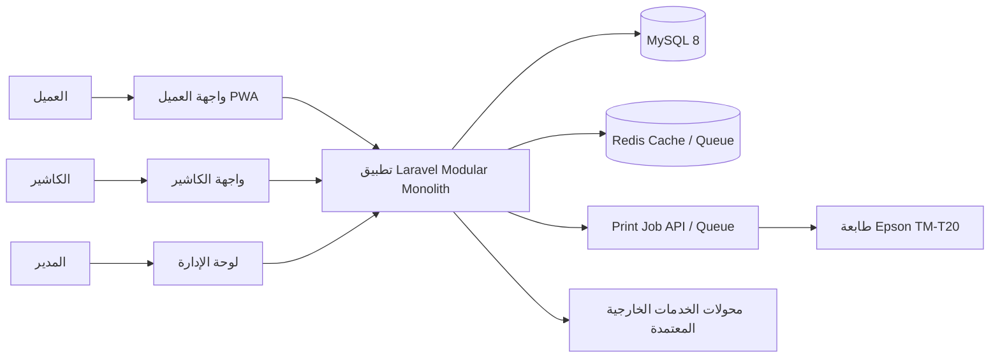
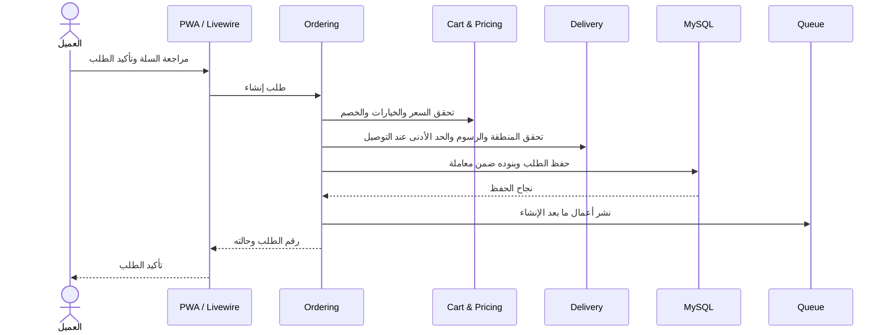
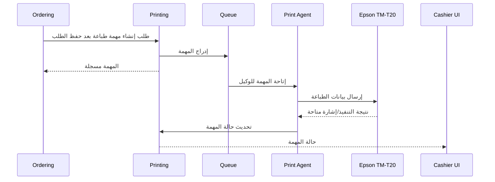

# وثيقة المعمارية البرمجية لنظام فتوش (Software Architecture)

| الحقل | القيمة |
|---|---|
| اسم النظام | فتوش – Fatoosh Restaurant System |
| معرّف الوثيقة | FRS-ARCH-001 |
| الإصدار | 0.1 |
| التاريخ | 22 نوفمبر 2026 |
| الحالة | مسودة تصميم للمراجعة والاعتماد |
| المستودع | `Malek-9292/kheralden92` |
| المرجع | `docs/01-SRS.md` – FRS-SRS-001 |
| نوع المعمارية | Modular Monolith |
| التقنيات المرجعية | PHP / Laravel / MySQL 8 / Livewire / Alpine.js / Redis / PWA |

> **حالة الوثيقة:** هذه وثيقة تصميم وليست تنفيذًا. لا تحتوي على كود أو قاعدة بيانات منشأة أو إعدادات تشغيل فعلية. يجب اعتمادها قبل الانتقال إلى التصميم التفصيلي للبيانات. تظل قرارات SRS المفتوحة غير محسومة هنا، ولا يجوز اعتبار أي اقتراح أدناه قرارًا تشغيليًا نهائيًا ما لم يُعتمد.

---

## 1. الهدف والمبادئ المعمارية

تحدد الوثيقة البنية التقنية المقترحة لنظام فتوش الجديد، وكيفية تقسيم المسؤوليات وحدود الوحدات وتواصلها ونشرها وتشغيلها. وهي مبنية على نطاق ومتطلبات وثيقة SRS الإصدار 0.1.

### 1.1 المبادئ الحاكمة

1. **الاستقلال التام:** النظام الجديد مستقل عن أي مستودع أو قاعدة بيانات أو إعدادات سابقة. لا نسخ ولا ترحيل ولا تعديل للقديم.
2. **Modular Monolith:** تطبيق Laravel واحد في البداية، مقسم إلى وحدات ذات مسؤوليات وحدود واضحة، وليس مجموعة خدمات Microservices.
3. **ملكية واضحة للبيانات:** لكل نطاق وظيفي مسؤولية واضحة عن بياناته وقواعد تعديلها.
4. **التواصل المنضبط:** لا تستدعي الوحدة التفاصيل الداخلية لوحدة أخرى مباشرة؛ تستخدم عقودًا وخدمات تطبيقية وأحداثًا موثقة.
5. **الأمان افتراضيًا:** التحقق من الهوية والصلاحية وقواعد العمل على الخادم، مع أقل صلاحية لازمة.
6. **الاعتمادية:** فشل الطباعة أو الإشعارات أو خدمة خارجية لا يفقد الطلب ولا يلغي نجاح تسجيله.
7. **قابلية القياس والتوسع:** Cache وQueue وفهارس ومراقبة واختبارات أداء؛ لا وعود سعة قبل القياس.
8. **قابلية الاختبار والصيانة:** حدود قابلة للاختبار، migrations، سجلات موحدة، واختبارات آلية.
9. **التوسع للفروع:** دعم الفرع ضمن نموذج التصميم من البداية، مع بدء التشغيل بفرع فتوش الخالدية فقط.
10. **لا تغيير صامت:** أي تغيير في حدود الوحدات أو التقنية أو المتطلبات يوثق ويعتمد.

### 1.2 ما لا تستهدفه المعمارية

- لا تستهدف Microservices في الإصدار الأول.
- لا تفصل كل وحدة وظيفية من قائمة SRS إلى خدمة أو تطبيق مستقل.
- لا تجعل المتصفح مصدرًا موثوقًا للأسعار أو الصلاحيات أو حالات الدفع.
- لا تربط نجاح الطلب بنجاح الطباعة.
- لا تسمح بتعطيل وحدة عبر حذف مجلداتها أو ملفاتها.
- لا تفترض مزود دفع أو رسائل أو خرائط أو استضافة قبل قرار مستقل.

## 2. السياق العام للنظام

### 2.1 الأطراف والواجهات

| الطرف | وسيلة الوصول | المسؤولية |
|---|---|---|
| العميل | واجهة ويب متجاوبة / PWA | تصفح القائمة وإنشاء الطلب ومتابعته وإدارة بياناته |
| الكاشير | واجهة تشغيل داخل النظام | استقبال الطلبات وإدارتها والمدفوعات والوردية والطباعة وفق الصلاحيات |
| المدير | لوحة الإدارة | إعداد النظام والمنتجات والطلبات والمستخدمين والتقارير والوحدات |
| Print Agent | خدمة/تطبيق محلي على جهاز الطباعة | استلام مهام الطباعة وتنفيذها وإرجاع الحالة |
| خدمات خارجية مستقبلية | محولات تكامل محددة | الدفع أو الرسائل أو الخرائط عند اعتمادها |

توجد ثلاثة أنواع مستخدمين رئيسية فقط: العميل والكاشير والمدير. الأدوار التفصيلية للمدير والكاشير تضبط بمصفوفة صلاحيات لاحقة.

### 2.2 مخطط السياق



المخطط منطقي؛ طريقة اتصال Print Agent الدقيقة (اتصال صادر آمن، polling، أو قناة أخرى) قرار تصميم تفصيلي يجب اختباره مع أجهزة Android الفعلية قبل التنفيذ.

## 3. البنية التقنية عالية المستوى

### 3.1 طبقات النظام

1. **Presentation Layer:** صفحات Livewire وواجهات العميل والكاشير والإدارة ومكونات Alpine.js.
2. **Application Layer:** حالات الاستخدام (Use Cases)، تنسيق العمليات، التحقق من المدخلات، وإدارة المعاملات.
3. **Domain Layer:** قواعد العمل والكيانات والسياسات وانتقالات الحالات وحسابات الطلب.
4. **Infrastructure Layer:** مستودعات البيانات، MySQL، Redis، Queue، التخزين، السجلات، ومحولات الخدمات الخارجية.
5. **Print Agent Layer:** مكوّن محلي مستقل عن دورة طلب HTTP، مسؤول عن الاتصال بالطابعة وإبلاغ النظام بالنتيجة.

لا يعني هذا التقسيم فرض إطار معقد؛ الهدف منع اختلاط قواعد العمل بالواجهات أو تفاصيل قواعد البيانات والطابعات.

### 3.2 التقنيات المرجعية

| المجال | التقنية / القرار |
|---|---|
| Backend | PHP + Laravel |
| واجهات الويب | Laravel Livewire + Alpine.js |
| قاعدة البيانات | MySQL 8 |
| Cache / Queue | Redis |
| تطبيق العميل | PWA |
| الطباعة | Print Agent مستقل |
| تنظيم التطبيق | Modular Monolith |
| العملة | KWD |
| اللغة الأساسية | العربية |

إصدارات الحزم وأدوات البناء والاستضافة ومزود التخزين لم تُحسم في SRS، وتحدد في وثيقة بيئة التطوير والتشغيل بعد اعتماد الميزانية والمتطلبات.

## 4. تقسيم النطاق إلى وحدات معمارية

قوائم 26 وحدة للعميل و48 للإدارة و40 للكاشير في SRS هي وحدات وظيفية. لا تتحول كل واحدة تلقائيًا إلى وحدة كود منفصلة. لتقليل التعقيد، تُجمع في نطاقات أعمال (Bounded Modules) مستقلة نسبيًا.

### 4.1 النطاقات المقترحة

| # | النطاق المعماري | المسؤوليات الرئيسية | الوحدات الوظيفية التابعة من SRS |
|---:|---|---|---|
| 1 | Identity & Access | الحسابات والجلسات والأدوار والصلاحيات | Customer Account/Profile، Admin Users، Roles & Permissions، Authentication & Security، Cashier Authentication/Permissions |
| 2 | Catalog | الأقسام والمنتجات والصور والخيارات والتوفر والأكثر طلبًا | Categories، Products، Product Options، Product Images، Product Availability، Best Sellers |
| 3 | Storefront & Content | واجهة المتجر والتنقل والبحث والبنرات ومعلومات المطعم والمظهر | Storefront، Navigation، Search، Banners، Website Content، Restaurant Information، Appearance |
| 4 | Customer & Addresses | بيانات العميل والعناوين والتفضيلات والمفضلة | Customer Profile، Address Book، Customer Addresses، Favorites، Preferences، Customer Management |
| 5 | Delivery Configuration | مناطق التوصيل والتغطية والرسوم والحد الأدنى | Delivery Areas، Delivery Fees، Delivery Settings، Delivery Information |
| 6 | Cart & Pricing | السلة وحساب الأسعار والخصومات والقسائم | Cart، Coupons & Discounts، Coupons Management، Offers Management |
| 7 | Ordering | إنشاء الطلب وتفاصيله وتعديلاته وإلغاؤه وحالاته | Checkout، Order Confirmation، Order Tracking، My Orders، Order Cancellation، Orders Management، Order Details، Order Status، Manual Order Creation، Order Editing |
| 8 | Payments & Cash | وسائل الدفع وحالاتها والاسترداد والصندوق والوردية | Payment، Payments Management، Payment Processing/Verification، Refund Management، Cash Register، Shift Closing |
| 9 | Kitchen Operations | توجيه الطلبات للمطبخ ومتابعة التحضير | Kitchen Management، Kitchen Dispatch، Kitchen Status Monitoring |
| 10 | Printing | الطابعات ومهام الطباعة والقوالب وإعادة الطباعة | Printer Management، Invoice Management، Receipt Printing، Automatic Printing، Kitchen Printing، Reprint Management، Printer Status |
| 11 | Notifications & Support | الإشعارات والدعم والتواصل الداخلي | Notifications، Customer Support، Cashier Notifications، Internal Communication |
| 12 | Reviews & Feedback | التقييمات والمراجعات | Reviews & Ratings، Customer Reviews |
| 13 | Branches | تعريف الفروع ونطاق بياناتها وإعداداتها | Branches Management، Branch Operations |
| 14 | Inventory | بيانات المخزون وحركاته وفق السياسة المعتمدة | Inventory Management |
| 15 | Reporting & Audit | التقارير وسجلات النشاط والتدقيق | Dashboards، Financial/Cashier/Order Reports، Activity Logs، Audit & Compliance |
| 16 | Platform & Operations | الإعدادات والنسخ الاحتياطي والمراقبة والأخطاء والتكاملات وإدارة الوحدات | General Settings، Module Manager، Database Management، Backup & Restore، System Monitoring، Error Management، API & Integrations، System Logs |

**ملاحظة:** هذا تجميع معماري مقترح وليس إعادة تعريف أو حذفًا لأي وحدة وظيفية من SRS. يتم إعداد مصفوفة تتبع تفصيلية بين كل وحدة من القوائم الثلاث والنطاق المعماري قبل التنفيذ.

### 4.2 الهيكل المنطقي المقترح للمستودع

الأسماء التالية مقترحة للتنظيم فقط، وليست ملفات تم إنشاؤها:

```text
app/
  Modules/
    IdentityAccess/
    Catalog/
    Storefront/
    Customer/
    Delivery/
    CartPricing/
    Ordering/
    PaymentsCash/
    Kitchen/
    Printing/
    NotificationsSupport/
    Reviews/
    Branches/
    Inventory/
    ReportingAudit/
    Platform/
  Shared/
    Contracts/
    Events/
    ValueObjects/
    Exceptions/
    Support/
resources/
  views/
    customer/
    cashier/
    admin/
  js/
routes/
  web.php
  api.php
database/
  migrations/
  seeders/
tests/
  Unit/
  Feature/
  Integration/
docs/
```

داخل كل نطاق يمكن تنظيم العناصر إلى:
- Domain: قواعد العمل والكيانات والسياسات.
- Application: حالات الاستخدام والخدمات المنسقة.
- Infrastructure: تنفيذ التخزين والتكاملات.
- Presentation: صفحات أو مكونات الواجهة عند الحاجة.
- Contracts: الواجهات العامة التي يسمح للنطاقات الأخرى باستخدامها.

يجب اعتماد الهيكل النهائي قبل إنشاء الملفات، وتجنب إنشاء طبقات فارغة لمجرد الالتزام بالشكل.

## 5. حدود الوحدات وملكية البيانات

### 5.1 قواعد الحدود

- كل نطاق مسؤول عن قواعد العمل الخاصة به.
- لا تعدل وحدة جداول أو كيانات نطاق آخر مباشرة.
- الوصول إلى بيانات نطاق آخر يكون عبر عقد/خدمة معلنة أو استعلام قراءة مخصص معتمد.
- لا توجد استدعاءات دائرية بين النطاقات.
- لا يُسمح للواجهات باستدعاء طبقة Infrastructure مباشرة.
- العمليات متعددة النطاقات تنسقها Application Use Case واضح، وتحدد حدود المعاملة بعناية.
- لا تُستخدم الأحداث كبديل غامض لاستدعاء يحتاج نتيجة فورية.

### 5.2 ملكية البيانات المنطقية

| البيانات | المالك المنطقي |
|---|---|
| المستخدمون والأدوار والصلاحيات | Identity & Access |
| الأقسام والمنتجات والخيارات والصور | Catalog |
| بيانات العميل والعناوين | Customer & Addresses |
| مناطق التوصيل والرسوم والحد الأدنى | Delivery Configuration |
| قواعد الأسعار والقسائم | Cart & Pricing |
| الطلب وبنوده وتاريخ حالاته | Ordering |
| وسيلة الدفع المختارة ضمن الطلب | Ordering |
| الورديات وحركات الصندوق النقدية عند اعتماد قواعدها | Cash Register & Shifts |
| حالة التحضير ومحطات المطبخ | Kitchen Operations |
| أجهزة الطباعة ومهامها ومحاولاتها | Printing |
| الإشعارات وطلبات الدعم | Notifications & Support |
| الفروع | Branches |
| حركات وكميات المخزون | Inventory |
| السجلات والتقارير التشغيلية | Reporting & Audit / Platform بحسب نوع السجل |

هذه ملكية منطقية. التصميم الفيزيائي للجداول والعلاقات والفهارس ومفاتيح الفروع يؤجل إلى وثيقة Database Design.

## 6. التواصل بين الوحدات

### 6.1 أنماط التواصل المسموح بها

1. **استدعاء خدمة/عقد مباشر:** عندما تحتاج العملية نتيجة فورية، مثل التحقق من تغطية منطقة أو قراءة سعر معتمد.
2. **حدث داخلي:** للإبلاغ عن واقعة تمت، مثل إنشاء طلب أو تغيير حالته، كي تتفاعل معها وحدات أخرى دون ربط مباشر.
3. **Queue/Job:** للعمليات الخلفية أو القابلة لإعادة المحاولة، مثل إرسال إشعار أو مهمة طباعة.
4. **واجهة قراءة محددة:** لعرض بيانات لازمة دون كشف تفاصيل التخزين الداخلية.

### 6.2 أمثلة أحداث داخلية مقترحة

| الحدث | الجهة الناشرة | مستهلكون محتملون |
|---|---|---|
| OrderPlaced | Ordering | Kitchen، Printing، Notifications، Reporting |
| OrderStatusChanged | Ordering | Customer Notifications، Reporting |
| PaymentRecorded | Payments & Cash | Ordering، Reporting، Audit |
| PrintJobCreated | Printing | Queue Worker / Print Agent |
| PrintJobSucceeded | Printing | Cashier UI، Audit |
| PrintJobFailed | Printing | Cashier UI، Monitoring |
| ProductAvailabilityChanged | Catalog | Storefront، Cart validation |
| DeliveryRuleChanged | Delivery Configuration | Checkout validation، Cache invalidation |

أسماء الأحداث والعقود نهائية فقط بعد مراجعتها في تصميم تفصيلي. يجب أن تكون الأحداث قابلة للتتبع ولها معرف فريد وبيانات لازمة فقط، وألا تحمل أسرارًا أو بيانات شخصية غير ضرورية.

### 6.3 منع فقد الأحداث المهمة

عند اعتماد نشر أحداث مرتبط بعملية قاعدة بيانات، يجب استخدام نمط موثوق مثل Transactional Outbox أو آلية مكافئة؛ حتى لا تحفظ العملية ثم يضيع الحدث بسبب تعطل التطبيق. يحدد الاختيار النهائي في تصميم البيانات والتنفيذ.

## 7. تدفقات العمل المعمارية الأساسية

### 7.1 إنشاء طلب عميل



قواعد أساسية:
- الخادم يعيد التحقق من الأسعار والتوفر والخيارات والحد الأدنى والرسوم.
- يجب حماية إنشاء الطلب من التكرار باستخدام مفتاح idempotency أو آلية مكافئة.
- الاستلام من المطعم لا يتطلب عنوانًا ولا حدًا أدنى ولا رسوم توصيل.
- التوصيل يتطلب منطقة وعنوانًا صالحين.
- لا يتم اعتبار الطلب محفوظًا إلا بعد نجاح معاملة قاعدة البيانات.
- قرار حالة الطلب الابتدائية الدقيقة ما زال مفتوحًا في SRS.

### 7.2 الطباعة المستقلة عن إنشاء الطلب



- الطلب ومهمة الطباعة كيانان وحالتان منفصلتان.
- فشل الوكيل أو الطابعة لا يلغي الطلب.
- كل محاولة طباعة تسجل بمعرف ووقت ونتيجة.
- إعادة الطباعة عملية صريحة ومصرح بها ومميزة عن النسخة الأصلية.
- آلية اكتشاف الطابعة وإقرار نجاح الطباعة تختلف حسب بروتوكول الجهاز؛ لا يفترض أن مجرد إرسال bytes يثبت خروج الورقة فعليًا.
- توافق Android USB مع Epson TM-T20 يجب إثباته على الأجهزة المستهدفة قبل اعتماد طريقة الاتصال.

### 7.3 الدفع

لا يتكامل نظام فتوش في النطاق الحالي مع مزود دفع أو لوحة البنك أو جهاز KNET. يحفظ الطلب وسيلة الدفع المختارة فقط (نقدي، KNET، أو رابط دفع)، ولا ينشئ سجلات معاملات أو محاولات دفع أو حالات نجاح/فشل/تعليق أو تأكيد سداد. إنشاء رابط الدفع وإرساله يتم يدويًا من لوحة البنك الخارجية بواسطة الكاشير، خارج نظام فتوش. تظل أي وظيفة مستقبلية لتتبع الدفع أو الاسترداد خارج النطاق حتى اعتماد قرار منفصل.

## 8. تصميم الطباعة وPrint Agent

### 8.1 فصل المسؤوليات

- **Printing Module في Laravel:** إنشاء مهام الطباعة، حفظ القوالب والإعدادات، تحديد الوجهة، تتبع المحاولات والحالات، وإدارة إعادة الطباعة.
- **Print Agent:** تسجيل الجهاز، التحقق من هويته، استلام المهام المصرح بها، تنفيذ الطباعة المحلية، وإرجاع نتيجة التنفيذ والسجلات التقنية.
- **Printer Adapter:** طبقة داخل الوكيل تعزل بروتوكول/تعريف الطابعة عن منطق استقبال المهمة.

### 8.2 متطلبات أمنية

- لكل Agent هوية/اعتماد مستقل قابل للإبطال والتدوير.
- استخدام HTTPS واتصال موثق بين النظام والوكيل.
- عدم وضع مفاتيح سرية داخل تطبيق العميل أو مستودع عام.
- قصر الجهاز على الفروع والطابعات والمهام المصرح بها.
- عدم قبول أوامر تنفيذ عامة من الخادم؛ يقبل الوكيل نوع مهام طباعة محددًا فقط.
- تسجيل معرف المهمة والجهاز والنتيجة دون تسريب بيانات حساسة.
- حماية إعادة إرسال المهمة من التكرار، مع السماح بإعادة طباعة صريحة بمعرف جديد أو سياق موثق.

### 8.3 أسئلة لم تحسم بعد

- إصدار Android والأجهزة المستهدفة.
- طريقة الاتصال المفضلة بين Laravel والوكيل.
- هل يوجد جهاز Android واحد أم أكثر؟
- هل توجد محطات مطبخ وطابعات متعددة؟
- مقاس الورق وقالب الفاتورة وتذكرة المطبخ.

تظل هذه البنود مفتوحة إلى حين قرار المستخدم والاختبار العملي.

## 9. الأمان والصلاحيات

1. المصادقة وإدارة الجلسات تتم عبر آلية Laravel آمنة مناسبة للتطبيق.
2. Authorization مركزي بسياسات/صلاحيات على الخادم لكل عملية.
3. إخفاء زر في الواجهة لا يعد حماية.
4. عزل صلاحيات العميل والكاشير والمدير، مع أدوار فرعية للكاشير والمدير.
5. تطبيق أقل صلاحية لازمة.
6. حماية CSRF والجلسات والطلبات ومعدلات الاستخدام حسب نوع المسار.
7. التحقق من جميع المدخلات على الخادم.
8. الأسرار في إعدادات بيئية آمنة، ولا تحفظ في Git.
9. HTTPS إلزامي في الإنتاج.
10. تسجيل التغييرات الحساسة مع المنفذ والتوقيت والقيمة السابقة/الجديدة عند ملاءمة ذلك.
11. لا تسجل كلمات المرور أو أسرار الدفع أو رموز المصادقة.
12. أي عملية مالية أو إعادة طباعة أو استعادة نسخة احتياطية تخضع لصلاحية محددة وسجل تدقيق.

تفاصيل سياسات كلمات المرور والتحقق من الهاتف وانتهاء الجلسة والاحتفاظ بالبيانات تتطلب قرارات تفصيلية لاحقة.

## 10. الفروع وتعدد المستأجرين

النظام يبدأ بفرع واحد، لكنه يصمم لاستيعاب أكثر من فرع مستقبلًا.

### 10.1 مبدأ التصميم

- وجود معرف فرع في البيانات التشغيلية التي تتبع فرعًا، حيث يلزم.
- تحديد الفرع النشط في سياق الطلب والكاشير والإدارة.
- فرض نطاق الفرع على الاستعلامات والعمليات المصرح بها.
- إعدادات المنتجات والأسعار والتوفر ومناطق التوصيل والطابعات يمكن أن تكون عامة أو خاصة بالفرع وفق قرار أعمال لاحق.
- لا يعتبر وجود branch_id وحده ضمانًا للعزل؛ يجب فرضه في الخدمات والسياسات والاستعلامات واختبارات الأمان.

### 10.2 ما لم يُحسم

لا يحدد SRS بعد هل ستكون المنتجات والأسعار مشتركة أم قابلة للتخصيص لكل فرع، ولا متى يتم تفعيل تشغيل الفروع المتعددة. لا نفترض الإجابة في هذه الوثيقة.

## 11. الأداء والتوسع

- استخدام Redis للتخزين المؤقت والصفوف الخلفية.
- تحديد مفاتيح Cache وسياسات الإبطال عند تعديل المنتجات والأسعار ومناطق التوصيل.
- نقل الأعمال غير الفورية إلى Queue Workers.
- فهرسة الاستعلامات وفق أنماط الاستخدام الفعلية.
- Pagination للنتائج الكبيرة.
- منع N+1 Queries والتحميل غير الضروري.
- Rate Limiting للمسارات الحساسة.
- حماية الطلبات والمدفوعات وتحديث المخزون من التزامن والتكرار.
- قياس زمن الاستجابة ومعدل الأخطاء واستهلاك CPU/RAM واتصالات قاعدة البيانات والصفوف المتراكمة.
- زيادة عدد Workers أو موارد التطبيق بعد القياس، لا بالتخمين.
- تنفيذ Load/Stress Tests على بيئة مماثلة للإنتاج قبل تحديد سعة تشغيلية.

لا تتضمن الوثيقة أرقامًا ملزمة للطلبات المتزامنة أو زمن الاستجابة؛ مستهدفات الأداء ما زالت قرارًا مفتوحًا في SRS.

## 12. الاعتمادية والتعامل مع الفشل

| موضع الفشل | السلوك المعماري المطلوب |
|---|---|
| الطابعة غير متصلة | يبقى الطلب محفوظًا، وتفشل مهمة الطباعة أو تنتظر إعادة المحاولة |
| Print Agent غير متصل | تبقى المهمة في النظام ولا تضيع |
| Redis متوقف | لا يؤدي ذلك إلى فقد طلب سبق حفظه؛ يحدد سلوك التدهور وإعادة المحاولة في التنفيذ |
| خدمة إشعارات خارجية متوقفة | لا يمنع إنشاء الطلب أو تحديثه |
| مزود دفع لا يستجيب | تسجل حالة غير محسومة وفق عقد الدفع، ولا يسجل نجاح غير مؤكد |
| تكرار إرسال Checkout | تمنع آلية idempotency إنشاء طلب مكرر |
| تعارض تحديث الطلب | يرفض التحديث المتعارض أو يعاد تقييمه وفق حالة الطلب الحالية |
| فشل Worker | تعاد المهمة وفق سياسة retry محدودة مع تسجيل الخطأ |

يجب تحديد Dead-letter handling، حدود المحاولات، وفترات الانتظار في تصميم التشغيل.

## 13. السجلات والمراقبة

### 13.1 أنواع السجلات

- Application Logs للأخطاء والتشغيل.
- Audit Logs للعمليات الحساسة.
- Order Timeline لتاريخ حالات الطلب.
- Order Payment Method لحفظ وسيلة الدفع المختارة ضمن سجل الطلب فقط؛ لا توجد سجلات لحالة أو نتيجة معاملة دفع.
- Print Job Logs لمهام الطباعة ومحاولاتها.
- Queue/Worker Logs لتراكم المهام وفشلها.
- Security Events لمحاولات الدخول والرفض والتغييرات الحساسة.

### 13.2 مؤشرات المراقبة

- نجاح/فشل إنشاء الطلب.
- زمن تنفيذ Checkout.
- عدد المهام المنتظرة والفاشلة في Queue.
- نسبة نجاح الطباعة وزمن استجابة الوكيل.
- أخطاء HTTP والاستثناءات.
- زمن استعلامات قاعدة البيانات واتصالاتها.
- استهلاك الموارد ومساحة التخزين.
- نجاح النسخ الاحتياطي ونتائج اختبارات الاستعادة.

تحدد أدوات المراقبة ومزود التنبيه في مرحلة DevOps بعد اختيار الاستضافة.

## 14. البيئات والنشر

### 14.1 البيئات

1. Development: تطوير واختبار ببيانات تجريبية.
2. Staging/Testing: التحقق قبل النشر عند اعتماد البيئة.
3. Production: التشغيل الرسمي للمطعم.

كل بيئة لها إعدادات وأسرار وقاعدة بيانات مستقلة. قاعدة بيانات النظام الجديد مستقلة عن كل قواعد الأنظمة السابقة.

### 14.2 خط نشر مبدئي


يجب أن تتضمن خطة النشر migrations قابلة للمراجعة، نسخًا احتياطيًا مناسبًا، وفحصًا بعد النشر وإجراء rollback. لا يتم تعديل الإنتاج مباشرة دون مسار موثق.

## 15. Module Manager

### 15.1 الدور

إدارة حالة تفعيل وحدات النظام من خلال سجل إعدادات/تعريفات موثوق، وليس من خلال حذف الملفات أو تغيير الكود أثناء التشغيل.

### 15.2 ضوابط التفعيل والتعطيل

- لكل وحدة تعريف ثابت وإصدار واعتماديات معلنة.
- فحص الاعتماديات قبل التفعيل.
- منع تعطيل وحدة مطلوبة من وحدة فعالة، إلا إذا تم تعطيل/استبدال الاعتماد بطريقة معتمدة.
- فحص وجود ترحيلات أو بيانات أو مهام معلقة مرتبطة بالوحدة قبل التعطيل.
- عدم حذف بيانات الوحدة عند تعطيلها.
- تسجيل من نفذ التغيير ووقته ونتيجة الفحص.
- حماية إدارة الوحدات بصلاحية إدارية عالية.
- لا يسمح بتعطيل وحدات أساسية لازمة لتسجيل الدخول أو الطلبات أو سلامة البيانات.
- أي ترحيل عكسي أو حذف بيانات يتطلب إجراء منفصلًا وخطة استعادة، ولا يعد جزءًا تلقائيًا من التعطيل.

### 15.3 حدود النسخة الأولى

يجب تحديد الوحدات التي يمكن تعطيلها فعليًا والوحدات الأساسية الثابتة قبل التنفيذ. لا يفترض أن كل نطاق قابل للتعطيل.

## 16. استراتيجية الاختبارات

| المستوى | الهدف |
|---|---|
| Unit | اختبار قواعد العمل والحسابات وانتقالات الحالات |
| Module/Feature | اختبار حالات الاستخدام داخل كل نطاق |
| Integration | اختبار العقود والتفاعل بين النطاقات وقاعدة البيانات وRedis |
| End-to-End | اختبار تدفقات العميل والكاشير والمدير |
| Authorization | اختبار رفض الوصول غير المصرح به |
| Concurrency / Idempotency | اختبار الطلبات المكررة والتحديثات المتزامنة |
| Printing Compatibility | اختبار Agent والطابعة وأجهزة Android المستهدفة |
| Backup & Restore | إثبات قابلية استعادة البيانات |
| Load / Stress | قياس الأداء والسعة |
| UAT | اعتماد المستخدم للتدفقات التشغيلية |

كل متطلب قبول حرج في SRS يجب أن يرتبط بحالة اختبار واحدة أو أكثر قبل الإطلاق.

## 17. المخاطر المعمارية والتخفيف

| الخطر | الأثر | التخفيف |
|---|---|---|
| تضخم التطبيق أو تشابك الوحدات | صعوبة الصيانة | عقود وحدود وملكية بيانات ومراجعة اعتماديات |
| اعتماد دائري بين النطاقات | صعوبة الاختبار والتغيير | فحص dependency graph واستخدام أحداث/عقود |
| تكرار الطلب أو الدفع | أثر مالي وتشغيلي | Idempotency ومعاملات واختبارات تزامن |
| اعتبار إرسال الطباعة نجاحًا مؤكدًا | فقد تذاكر أو تكرارها | حالات طباعة مستقلة وإقرار من الوكيل واختبار جهاز فعلي |
| تعطل Redis أو Worker | تأخر المهام | مراقبة وإعادة محاولة وعدم جعل Queue شرطًا لحفظ الطلب |
| تسرب بيانات بين الفروع مستقبلًا | خطر أمني | نطاق فرع إلزامي وسياسات واختبارات عزل |
| توسع غير مقاس | تكلفة أو بطء | اختبارات حمل ومراقبة قبل زيادة البنية |
| تغييرات غير موثقة | اختلاف التنفيذ عن المتطلبات | إدارة إصدارات واعتماد التغييرات |

## 18. قرارات تتطلب اعتمادًا قبل تثبيت التصميم

ترتبط هذه النقاط بقرارات SRS المفتوحة، ولا تحسمها المعمارية من تلقاء نفسها:

1. حالات الطلب النهائية وانتقالاتها.
2. مزود الدفع ووسائله وسياسات الاسترداد.
3. أوقات العمل والطلبات المجدولة.
4. سياسة الطلب كضيف.
5. سياسة الإلغاء.
6. قواعد الخصومات وتعارضها.
7. تقدير أوقات التجهيز والتوصيل.
8. قالب الفاتورة وتذكرة المطبخ ومقاس الورق.
9. أجهزة Android وإصداراتها المستهدفة.
10. عدد محطات المطبخ والطابعات وتوجيه المهام.
11. خصم المخزون آليًا أم لا.
12. أدوار المدير.
13. أدوار الكاشير وحدود العمليات المالية.
14. بيانات مناطق الكويت والرسوم والحد الأدنى.
15. الاحتفاظ بالبيانات والخصوصية.
16. الاستضافة والنطاق والنسخ الاحتياطي.
17. مستهدفات الأداء وRPO/RTO.
18. موعد تفعيل الفروع المتعددة.

## 19. مخرجات المرحلة التالية

بعد مراجعة واعتماد هذه الوثيقة:

1. إعداد مصفوفة تتبع تربط وحدات SRS بالنطاقات المعمارية.
2. اعتماد عقود الوحدات والأحداث والاعتماديات.
3. إعداد مخطط ERD وتصميم الجداول والفهارس وسياسات البيانات.
4. إعداد سياسة الفروع والعزل على مستوى البيانات.
5. إعداد تصميم تفصيلي لتدفق الطباعة والوكيل والأمان.
6. مراجعة تصميم قاعدة البيانات واعتماده قبل كتابة migrations أو كود التطبيق.

## 20. سجل التعديلات

| الإصدار | التاريخ | التغيير | الحالة |
|---|---|---|---|
| 0.1 | 2026-11-22 | إنشاء مسودة المعمارية المبنية على SRS 0.1 | بانتظار المراجعة والاعتماد |

---

**نهاية الوثيقة – FRS-ARCH-001**

## ملحق قرارات المعمارية المعتمدة – 23 نوفمبر 2026

- Identity & Access يدعم أدوار مدير كامل، مدير تشغيل، مدير محتوى، كاشير، ومشرف وردية، مع صلاحيات قابلة للتخصيص والتحقق خادميًا.
- الحسابات تدعم رقم الهاتف وكلمة المرور دون OTP في P0. تفصل بيانات الهوية الشخصية عن لقطات الطلبات لتسهيل إخفاء الهوية مع الاحتفاظ بالسجلات المحاسبية المطلوبة.
- Pricing يستخدم دقة ثلاث خانات عشرية KWD في التخزين والحساب والعرض، عبر خدمة تسعير مركزية تعتمد DECIMAL ولا تستخدم floating point.
- Delivery يدعم القائمة الكاملة للمناطق، ورسومًا وحدودًا قابلة للتعديل لكل منطقة، ومراجعة/قبول العميل لأي تغير في رسوم أو حد أدنى يطرأ على سلة مفتوحة. وضع الطوارئ يوقف التوصيل مع إبقاء الاستلام.
- Cashier Operations يدعم الورديات والأرصدة الافتتاحية والمقبوضات والإغلاق ومقارنة النقد المتوقع بالفعلي والفرق، دون إضافة وحدة مصروفات.
- Audit Log يسجل القيم قبل/بعد وهوية الفاعل والتوقيت للعمليات الحساسة، ويكون محميًا من التعديل العادي.
- Notifications P0 داخلية وصوتية؛ القنوات الخارجية المدفوعة مؤجلة. مراقبة الأعطال والتنبيه بالبريد تعتمد على مراقب خارجي عند توقف التطبيق.
- PWA يدعم تثبيت iOS/Android وعرض صفحات أساسية مخزنة دون اتصال، مع منع الكتابة والطلبات والدفع Offline.
- لا تكامل مع بوابة البنك أو مزود الدفع، ولا حفظ لحالة/نتيجة الدفع. المراجعة المالية والاسترداد الإلكتروني خارج النظام.
- التقارير والعملاء والتصدير والصور والبحث ووضع الطوارئ تتبع القرارات DEC-074 وDEC-077 وDEC-078.
- لا يضاف مخزون أو موردون أو مشتريات أو مصروفات إلى P0.

## إعدادات الهوية والألوان القابلة للتخصيص – DEC-079

تُدار ألوان الواجهات عبر Design Tokens/Theme Configuration مركزي قابل للإدارة من لوحة التحكم، لا عبر قيم لونية ثابتة موزعة داخل المكونات. يدعم النظام نطاقًا عامًا ونطاقات تخصيص منفصلة لواجهة العميل والإدارة والكاشير، مع معاينة ومسودة واعتماد ونشر للإعدادات. تحفظ الإصدارات السابقة لإتاحة الرجوع إلى آخر إعداد منشور. تطبق الألوان بصورة متسقة على الويب وPWA، مع فحص التباين وإمكانية الوصول. لا يعتمد أي لون بعينه كقيد ثابت على المالك.

## دعم تخصيص العنصر الفردي – DEC-080

إلى جانب Design Tokens العامة والخاصة بكل واجهة، يجب أن يدعم نظام السمات تعيينات لونية على مستوى العنصر المحدد (element-level overrides) بمعرّف مستقر، بحيث لا يغيّر تعديل عنصر بعينه بقية العناصر المماثلة. يجب أن تكون التعيينات قابلة للمعاينة والإصدار والتراجع، مع ضوابط تمنع فقدان وضوح النصوص.

## قناة استعادة كلمة المرور – DEC-082

تُنفذ وظيفة استعادة كلمة مرور العميل بالاعتماد على البريد الإلكتروني بوصفه قناة الاستعادة الوحيدة المعتمدة. لا تعتمد هذه الوظيفة على رقم الهاتف. تُحدد تفاصيل آلية الاستعادة وضوابطها الأمنية ضمن التصميم والتنفيذ الأمنيين.

## إدارة البريد الإلكتروني ورقم الهاتف – DEC-083

يُعامل البريد الإلكتروني كبيان اختياري للحساب، لكنه شرط لمسار استعادة كلمة المرور، ويجب التحقق منه قبل استخدامه. عند الإضافة أو التغيير، يُعتمد البريد الجديد بعد إتمام التحقق برسالة تأكيد. تغيير رقم الهاتف عملية إدارية محكومة بالصلاحيات ولا ينفذها العميل من حسابه.

## حساب العميل والخصوصية – DEC-084

تدعم خدمات الحساب تحديث اسم العميل وكلمة مروره، وقراءة سجل طلباته وفواتيره، وطلب حذف الحساب، وإدارة موافقة التسويق، وإبطال جلسات الدخول على جميع الأجهزة. يجب أن يتكامل حذف الحساب مع سياسة الاحتفاظ بالسجلات المالية وإخفاء البيانات الشخصية المحددة في DEC-072، وألا يؤدي إلى حذف السجلات المالية المطلوبة.

## خدمات تجربة الطلب – DEC-085

تدعم خدمات الطلب إعادة إنشاء طلب من طلب سابق مع إعادة تسعير والتحقق من إتاحة الأصناف وفق بياناتها الحالية، وإدارة عدة عناوين توصيل للعميل، واختيار عنوان محفوظ أو إنشاء عنوان جديد أثناء إتمام الطلب. تحفظ الملاحظة العامة للطلب منفصلة عن ملاحظات الأصناف. لا توفر واجهات لتعديل الطلب بعد إرساله أو لجدولة موعد مستقبلي؛ ويعرض النظام ساعات العمل وحالة استقبال الطلبات.

## تشغيل الطلبات والكاشير – DEC-086

تدعم وحدة الكاشير إشعارًا صوتيًا للطلبات الجديدة، ورفض الطلب مع حفظ السبب، والبحث برقم الطلب أو هاتف العميل، وعرض الطلبات الملغاة. يجب أن تسجل خدمة الطباعة كل إعادة طباعة مع المستخدم والتوقيت. تتطلب عملية الإلغاء سببًا إلزاميًا، وتمنع قواعد الورديات إعادة فتح الوردية المغلقة. تظل سياسات الإلغاء والمراجعة المالية في DEC-075 هي المرجع الحاكم.

## التقارير والإرسال الدوري – DEC-087

تجمع وحدة التقارير بيانات الطلبات المكتملة/المعتمدة وفق قواعد احتساب المبيعات المعتمدة، وتوفر مؤشرات اليوم ومقارنته بالأمس، والتوزيع الساعي للطلبات، وأداء الكاشير، وترتيب الأصناف صعودًا وهبوطًا. تدعم طبقة التصدير Excel وPDF وفترات زمنية مخصصة. تُنفذ رسائل التقارير التلقائية عبر مهمة مجدولة وخدمة بريد، مع إعدادات قابلة للإدارة لدورية الإرسال والمستلمين، وسجلات نجاح/فشل الإرسال.

## إلغاء الإرسال التلقائي للتقارير – DEC-088

لا حاجة إلى مهمة مجدولة أو خدمة بريد لإرسال تقارير المبيعات تلقائيًا. تظل وحدة التقارير والتصدير اليدوي إلى Excel وPDF قائمة وفق DEC-087.

## أحداث الإشعارات وتوجيهها – DEC-089

تنتج وحدات الطلبات والطباعة والنظام أحداثًا للإشعار عند إلغاء الطلب أو رفضه أو انقطاع الطابعة أو فشل الطباعة أو حدوث خطأ بالنظام. تحفظ خدمة الإشعارات سجلًا قابلًا للعرض في لوحة الإدارة، وتطبق قواعد توجيه قابلة للضبط حسب الدور الوظيفي. تظل قنوات الإرسال محددة وفق DEC-068.

## النسخ الاحتياطي والاستعادة – DEC-090

تُنفذ جدولة نسخ قاعدة البيانات كل 12 ساعة، مع إرسال نسخة مشفرة إلى وجهة تخزين خارج خادم الاستضافة والاحتفاظ بها 30 يومًا. يجب فصل صلاحيات النسخ عن صلاحيات الاستعادة؛ الاستعادة ينفذها المطور فقط خارج لوحة الإدارة. تُختبر قابلية الاستعادة دوريًا، وتسجل عمليات النسخ والاستعادة في سجل تدقيق محمي.

## أمان جلسات الإدارة وسجل النشاط – DEC-091

تطبق جلسات الإدارة مهلة خمول مدتها 30 دقيقة، مع إعادة تحقق بكلمة المرور للعمليات الحساسة. تطبق خدمة المصادقة تحديدًا مؤقتًا لمحاولات الدخول بعد تكرار كلمات المرور الخاطئة، وفق عتبة ومدة قابلة للضبط ضمن سياسة الأمان. تسجل أحداث الدخول والخروج، وتدعم الإدارة إيقاف حساب الموظف فورًا. ترتبط تغييرات الأسعار والمنتجات والإعدادات بسجل التدقيق الذي يسجل المنفذ والتوقيت والقيم قبل/بعد. لا يعتمد النظام تقييد الدخول بقائمة أجهزة مسموح بها.

## إدارة الموظفين والصلاحيات – DEC-092

تدعم وحدة الهوية والصلاحيات صلاحية زمنية لحساب الموظف ببداية ونهاية، وحالات تفعيل وإيقاف مؤقت مع الاحتفاظ بالسجل. تدعم نسخ مجموعات الصلاحيات بين الموظفين، وتفويضًا دقيقًا على مستوى العملية. يجب تطبيق التفويض في الخادم؛ إخفاء عناصر الواجهة لتحسين التجربة فقط ولا يعد بديلًا عن التحقق الخادمي. تسجل محاولات الوصول المرفوضة، وتوفر آلية لتحديد الجلسات النشطة والموظفين الموجودين حاليًا داخل النظام.

## إدارة محتوى واجهة العميل – DEC-093

تدعم وحدة إدارة المحتوى ترتيب الأقسام والأصناف بشكل مستقل، والتحكم في إتاحة الصنف دون حذف بياناته. تدعم إدارة البنرات والعروض أكثر من عنصر مع جدولة زمنية لبداية ونهاية الظهور. تُدار نصوص الواجهة وتسميات الأزرار والعناوين من إعدادات المحتوى. يجب فصل حالة المسودة عن النسخة المنشورة، وتوفير معاينة قبل النشر حتى لا تؤثر التعديلات غير المعتمدة على العملاء.

