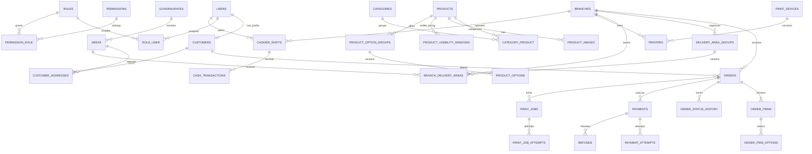

# تصميم قاعدة بيانات نظام فتوش (Database Design)

| الحقل | القيمة |
|---|---|
| اسم النظام | فتوش – Fatoosh Restaurant System |
| معرّف الوثيقة | FRS-DB-001 |
| الإصدار | 0.1 |
| التاريخ | 22 نوفمبر 2026 |
| الحالة | مسودة تصميم للمراجعة والاعتماد |
| المستودع | `Malek-9292/kheralden92` |
| مرجع المتطلبات | `docs/01-SRS.md` – FRS-SRS-001 |
| مرجع المعمارية | `docs/02-ARCHITECTURE.md` – FRS-ARCH-001 |
| محرك قاعدة البيانات | MySQL 8 |

> **تنبيه:** هذه وثيقة تصميم منطقي ومبدئي، وليست قاعدة بيانات منشأة أو migrations منفذة. أسماء الجداول والحقول والقيود المقترحة تحتاج مراجعة واعتمادًا. القرارات المفتوحة في SRS لا يتم حسمها ضمنيًا هنا. لا يوجد أي اتصال أو ترحيل أو نسخ من قاعدة بيانات المشروع القديم.

---

## 1. أهداف التصميم

1. تمثيل بيانات النظام الوظيفية المحددة في SRS.
2. تطبيق حدود وملكية البيانات الموضحة في وثيقة المعمارية.
3. دعم التشغيل الأول بفرع فتوش الخالدية، مع قابلية إضافة فروع مستقبلًا.
4. حماية سلامة الطلبات والأسعار والإجماليات من التكرار والتعارض.
5. الاحتفاظ بلقطة ثابتة من بيانات الطلب وقت إنشائه، حتى لا تتغير الفاتورة التاريخية بتعديل المنتج.
6. فصل حالة الطلب عن حالة الطباعة، مع حفظ وسيلة الدفع المختارة فقط دون حالة دفع.
7. دعم السجلات والتدقيق والنسخ الاحتياطي والاستعادة.
8. بناء تصميم قابل للاختبار والتوسع دون إنشاء جداول أو علاقات غير لازمة قبل اعتماد نطاقها.

## 2. قواعد التصميم العامة

### 2.1 التسمية والأنواع

- أسماء الجداول والحقول التقنية باللغة الإنجليزية وبصيغة snake_case.
- استخدام مفاتيح أساسية موحدة، ويُحسم نوعها النهائي بين BIGINT أو UUID/ULID قبل migrations.
- استخدام InnoDB لدعم المعاملات والعلاقات.
- استخدام UTF-8 عبر `utf8mb4` للنصوص العربية والإنجليزية.
- استخدام `DATETIME` أو `TIMESTAMP` بتوحيد سياسة التخزين الزمني والمنطقة الزمنية قبل التنفيذ.
- استخدام `DECIMAL` للقيم المالية وعدم استخدام FLOAT/DOUBLE للأموال.
- استخدام `JSON` فقط للبيانات المرنة أو اللقطات التي لا تحتاج استعلامًا علائقيًا متكررًا؛ لا يكون بديلًا عن الجداول العلائقية الأساسية.
- كل جدول تشغيلي يحتاج حقول الإنشاء والتحديث المناسبة. لا تضاف حقول حذف منطقي تلقائيًا لكل الجداول؛ تحدد حسب طبيعة السجل.
- تجنب الحذف الفعلي للطلبات والمدفوعات والسجلات المالية ومهام الطباعة.

### 2.2 العملة والدقة المالية

العملة التشغيلية هي الدينار الكويتي، وقد اعتُمد عرض المبالغ بثلاث خانات عشرية (مثال: `1.250 د.ك`). يظل استخدام `DECIMAL(12,3)` مقترحًا لتخزين المبالغ ويحتاج تثبيتًا ضمن التصميم النهائي؛ كما تظل قواعد التقريب الحسابي وتوزيع الخصم مفتوحة ولا تُستنتج من قرار تنسيق العرض. يجب توحيد طريقة حساب الخصم والرسوم والإجمالي على الخادم.

### 2.3 علاقات الفروع

- بيانات الفرع ترتبط بفرع محدد عندما تكون بطبيعتها تشغيلية أو خاصة بفرع.
- لا يضاف `branch_id` عشوائيًا إلى كل جدول؛ تحدد ملكية كل سجل.
- لا يعتبر وجود `branch_id` وحده كافيًا لعزل البيانات؛ يجب فرض نطاق الفرع في الخدمات والصلاحيات والاستعلامات والاختبارات.
- مشاركة المنتجات والأسعار ومناطق التوصيل بين الفروع لم تُحسم بعد. لذلك يوضح التصميم مواضع الارتباط المقترحة مع ترك سياسة المشاركة مفتوحة.

### 2.4 سلامة البيانات

- كل طلب يحتفظ بلقطة اسم المنتج وسعره وخياراته وكميته وقت الطلب.
- كل عملية مالية ترتبط بالطلب وتسجل مرجعها وحالتها ومبلغها.
- كل مهمة طباعة لها سجل مستقل ومحاولات مستقلة.
- كل تغيير حالة طلب يسجل في تاريخ حالات لا يستبدل بسجل الحالة الحالية.
- مفاتيح منع التكرار مطلوبة في إنشاء الطلب وتسجيل الدفع واستقبال نتيجة الطباعة عند الحاجة.
- يجب أن تكون القيود الحرجة في قاعدة البيانات بالإضافة إلى التحقق في التطبيق، لا بدلًا عنه.

## 3. خريطة نطاقات البيانات

| النطاق المعماري | مجموعات البيانات |
|---|---|
| Identity & Access | المستخدمون، الأدوار، الصلاحيات، الربط بينها |
| Branches | الفروع وإعداداتها |
| Catalog | الأقسام، المنتجات، الصور، مجموعات الخيارات، الخيارات، التوفر |
| Customer & Addresses | ملفات العملاء، العناوين |
| Delivery Configuration | المحافظات/المناطق، تغطية الفرع، رسوم التوصيل، الحد الأدنى |
| Cart & Pricing | قواعد الخصم والقسائم واستخدامها |
| Ordering | الطلبات، البنود، الخيارات المختارة، تاريخ الحالات، مفاتيح منع التكرار |
| Ordering | وسيلة الدفع المختارة المحفوظة ضمن الطلب |
| Cash Register & Shifts | الورديات وحركات الصندوق النقدية وفق سياسة تشغيلية تعتمد لاحقًا |
| Kitchen Operations | محطات المطبخ، عناصر التوجيه، حالات التحضير عند اعتماد تفاصيلها |
| Printing | الأجهزة، الطابعات، مهام الطباعة، محاولات التنفيذ |
| Notifications & Support | الإشعارات وسجلات الإرسال وطلبات الدعم |
| Reviews | التقييمات والمراجعات |
| Inventory | الأصناف المخزنية والحركات والربط بالمنتجات عند اعتماد سياسة المخزون |
| Reporting & Audit | سجلات التدقيق وسجلات النظام |
| Platform | إعدادات النظام، تعريفات الوحدات، Outbox، النسخ الاحتياطي وسجلاته |

هذه خريطة ملكية منطقية وليست مخطط جداول نهائيًا لكل نطاق. الجداول الخاصة بالميزات التي لم يعتمد نطاقها توضع في قسم القرارات المفتوحة ولا تعتبر مطلوبة للتنفيذ الفوري.

## 4. تصميم الجداول المقترح

### 4.1 المستخدمون والصلاحيات (Identity & Access)

| الجدول | الحقول الأساسية المقترحة | الغرض |
|---|---|---|
| `users` | id، name، phone، email، password، user_type، is_active، phone_verified_at، email_verified_at، last_login_at، timestamps | حسابات الدخول للأنواع الرئيسية الثلاثة |
| `roles` | id، name، code، description، guard_name، timestamps | الأدوار الفرعية للمدير والكاشير |
| `permissions` | id، name، code، description، timestamps | الصلاحيات الدقيقة |
| `role_user` | role_id، user_id، assigned_by، created_at | ربط المستخدم بالأدوار |
| `permission_role` | permission_id، role_id، created_at | ربط الصلاحيات بالأدوار |
| `user_branch_access` | user_id، branch_id، access_level، created_at | نطاق الفروع المسموح للمستخدم بالوصول إليها عند تعدد الفروع |

**قواعد:**
- `user_type` يقتصر على Customer وCashier وAdmin وفق SRS؛ لا ينشأ نوع رئيسي رابع.
- حساب العميل يمكن أن يكون مرتبطًا بملف عميل منفصل أو تتم تسوية العلاقة في التصميم النهائي؛ يجب ألا يتكرر رقم الهاتف بصورة غير مقصودة.
- بيانات المصادقة لا تعرض في واجهات الإدارة أو السجلات.
- تفاصيل الأدوار الافتراضية للكاشير والمدير لم تعتمد بعد.

### 4.2 الفروع (Branches)

| الجدول | الحقول الأساسية المقترحة | الغرض |
|---|---|---|
| `branches` | id، code، name، address، phone، is_active، timezone، timestamps | تعريف الفروع |
| `branch_settings` | id، branch_id، setting_key، setting_value، value_type، updated_by، timestamps | إعدادات قابلة للتخصيص لكل فرع عند الحاجة |

يبدأ التشغيل بسجل فرع واحد لفتوش الخالدية. لا يعني وجود الجدول تفعيل تعدد الفروع تشغيليًا في الإصدار الأول.

### 4.3 الأقسام والمنتجات (Catalog)

| الجدول | الحقول الأساسية المقترحة | الغرض |
|---|---|---|
| `categories` | id، parent_id nullable، name، slug، description، image_id nullable، sort_order، is_active، timestamps | شجرة أقسام متعددة المستويات؛ تكون قيمة `parent_id` فارغة للقسم الرئيسي، وتشير إلى القسم الأب للقسم الفرعي، ويمكن تكرار العلاقة لبناء مستويات إضافية حسب الحاجة. يجب منع ربط القسم بنفسه أو بأحد أحفاده لتجنب الدورات. |
| `products` | id، category_id، sku nullable، name، slug، description، ingredients، product_type، base_price، is_active، sort_order، preparation_time nullable، timestamps | بيانات المنتج الأساسية |
| `product_visibility_windows` | id، product_id، starts_at_time، ends_at_time، sort_order، timestamps | فترات ظهور يومية متعددة للمنتج؛ تتكرر كل يوم |
| `product_images` | id، product_id، storage_disk، storage_path، alt_text، sort_order، is_primary، timestamps | عدة صور لكل منتج مع ترتيب عرض واضح وصورة أساسية واحدة فقط لكل منتج؛ يجب فرض عدم وجود أكثر من صورة أساسية واحدة للمنتج والتحقق من ارتباط كل صورة بمنتج واحد |
| `category_product` | غير مستخدم في نموذج الإطلاق | لا تُستخدم علاقة متعدد-لمتعدد؛ يخزن كل منتج `category_id` إلزاميًا يشير إلى قسم واحد فقط، ويمكن أن يكون القسم المختار في أي مستوى من شجرة الأقسام |
| `product_option_groups` | id، product_id، name، group_type، selection_type، min_select، max_select، is_required، sort_order، is_active | مجموعات اختيار اختيارية حسب الصنف، مثل الحجم أو الإضافات؛ لا يلزم إنشاء مجموعة حجم أو خيارات لصنف لا يدعمها |
| `product_options` | id، option_group_id، name، price_delta nullable، price_override nullable، is_active، sort_order | خيارات المنتج؛ يستخدم `price_override` للسعر النهائي المستقل لخيار الحجم، ويستخدم `price_delta` لفرق سعر الإضافة؛ لا يجتمع الحقلان للخيار نفسه |
| `branch_products` | id، branch_id، product_id، is_available، price_override nullable، timestamps | توفر/سعر المنتج على مستوى الفرع عند اعتماد هذا السلوك |

**ملاحظات تصميمية:**
- لا تضاف حقول حد أدنى أو حد أقصى لكمية الطلب على مستوى المنتج؛ لا يضع النظام قيود كمية مخصصة لكل صنف ضمن نطاق الإطلاق.
- `ingredients` يمكن أن يكون نصًا منظمًا أو علاقة مكونات منفصلة حسب الحاجة التشغيلية؛ لا حاجة لجدول مكونات مستقل قبل اعتماد إدارة المخزون والوصفات.
- مكونات صواني المشويات تعرض في تفاصيل الصنف فقط وفق SRS؛ مكان حفظها لا يفرض ظهورها في القائمة.
- الصمون قاعدة عرض/إعداد افتراضي للسندويتشات، والاستثناءات مثل الصاج تسجل على المنتج أو خيار الخبز المعتمد. لا ينبغي استنتاج الخبز من اسم المنتج آليًا دون قاعدة واضحة.
- صور المنتج تحفظ كمسارات تخزين لا كملفات BLOB داخل MySQL.
- لكل منتج صفر أو أكثر من فترات الظهور اليومية في `product_visibility_windows`؛ عدم وجود فترات يعني عدم تطبيق جدول زمني خاص بالمنتج.
- تتكرر الفترات المحددة يوميًا وفق توقيت الكويت (Asia/Kuwait). تحفظ أوقات البداية والنهاية كوقت يومي، ويجب التحقق من صحة النطاقات ومنع تداخل الفترات للمنتج نفسه.
- يجب أن يطبق الاستعلام عن قائمة العميل وفحص الإضافة للسلة وتأكيد الطلب شرط وقت الظهور على الخادم؛ لا يكفي إخفاء المنتج في الواجهة.
- هل السعر موحد أم خاص بكل فرع؟ القرار مفتوح؛ `branch_products.price_override` اقتراح لاستيعاب الاحتمال وليس اعتمادًا له.

### 4.4 العملاء والعناوين (Customer & Addresses)

| الجدول | الحقول الأساسية المقترحة | الغرض |
|---|---|---|
| `customers` | id، user_id nullable، name، phone، email nullable، notes nullable، timestamps | ملف العميل، بما في ذلك إمكانية وجود طلب ضيف |
| `customer_addresses` | id، customer_id، governorate_id، area_id، block، street، avenue nullable، house_number، floor nullable، apartment nullable، label nullable، is_default، timestamps | عناوين العملاء المحفوظة |
| `governorates` | id، name، code nullable، sort_order، is_active | محافظات الكويت |
| `areas` | id، governorate_id، name، code nullable، sort_order، is_active | مناطق كل محافظة |

**قواعد العنوان:**
- المحافظة والمنطقة والقطعة والشارع ورقم المنزل إلزامية في عنوان التوصيل حسب SRS.
- الجادة والدور والشقة اختيارية.
- عنوان الاستلام من المطعم غير مطلوب.
- يجب الاحتفاظ بنسخة نصية من العنوان داخل الطلب وقت إنشائه، حتى لو تغير اسم المنطقة لاحقًا.
- لا يتم إنشاء سجل عنوان دائم للضيف إلا وفق سياسة الطلب كضيف التي ما زالت تحتاج اعتمادًا.

### 4.5 مناطق التوصيل وقواعدها

| الجدول | الحقول الأساسية المقترحة | الغرض |
|---|---|---|
| `delivery_area_groups` | id، branch_id، name، minimum_order_amount، is_active، sort_order، timestamps | مجموعات مناطق التوصيل، ولكل مجموعة حد أدنى موحد قابل للتطبيق على أعضائها |
| `branch_delivery_areas` | id، branch_id، area_id، delivery_area_group_id nullable، is_serviceable، delivery_fee، minimum_order_amount nullable، estimated_delivery_minutes nullable، timestamps | تغطية المنطقة ورسومها وحدها الأدنى الفردي الاختياري وتبعيتها لمجموعة |
| `delivery_rule_history` | id، branch_delivery_area_id، old_fee، new_fee، old_minimum، new_minimum، changed_by، changed_at، reason nullable | سجل تغييرات قواعد التوصيل |

**قواعد:**
- يمكن أن تكون المنطقة بلا مجموعة، وعندها يكون `branch_delivery_areas.minimum_order_amount` هو الحد الأدنى المطبق.
- إذا كانت المنطقة ضمن مجموعة، فإن `branch_delivery_areas.minimum_order_amount` عند وجود قيمة له يتقدم على حد المجموعة؛ وإذا كانت القيمة NULL يرث حد `delivery_area_groups.minimum_order_amount`.
- يمكن للمدير استخدام حد المجموعة الموحد لكل المناطق بترك حدود المناطق الفردية فارغة، أو تخصيص حد فردي لبعض المناطق، أو ترك مناطق أخرى خارج المجموعات بحدود مستقلة؛ هذه الأنماط متاحة بالتوازي.
- رسوم التوصيل تظل في `branch_delivery_areas.delivery_fee` لكل منطقة، ولا تُورث من المجموعة.
- يجب ألا تنتمي المنطقة لأكثر من مجموعة واحدة ضمن الفرع نفسه، مع قيد فريد مناسب على عضوية المنطقة.
- يجب التحقق من صلاحية المنطقة ورسومها والحد الأدنى الفعلي بعد تطبيق قاعدة الوراثة/التجاوز على الخادم عند إتمام الطلب.
- الطلب يحتفظ بقيم الرسوم والحد الأدنى المطبقة وقت الإنشاء في لقطة الطلب.
- قيمة الحد الأدنى لا تطبق على الاستلام من المطعم.
- الرسوم والحد الأدنى لكل منطقة لم يتم إدخالها بعد؛ هذه الوثيقة تحدد شكل البيانات فقط.
- إذا تقرر دعم سجل كامل للتغييرات، يعتمد جدول التاريخ أو سجل التدقيق العام؛ لا يلزم تكرار التسجيل في الاثنين بلا داعٍ.

### 4.6 السلة والخصومات

| الجدول | الحقول الأساسية المقترحة | الغرض |
|---|---|---|
| `carts` | id، customer_id nullable، session_key nullable، branch_id، order_type، expires_at، timestamps | سلة مؤقتة إذا اعتمد حفظ السلة في الخادم |
| `cart_items` | id، cart_id، product_id، quantity، selected_options_snapshot، notes، timestamps | عناصر السلة وخياراتها |
| `coupons` | id، code، description، discount_type، discount_value، order_type_scope (pickup / delivery / both)، starts_at، ends_at، usage_limit nullable، per_customer_limit nullable، minimum_order_amount nullable، max_discount_amount nullable، is_active، timestamps | تعريف القسائم؛ يحدد كل كوبون أنواع الطلب المسموح بها وفترة الصلاحية بوقت بداية ونهاية، وحدًا أدنى اختياريًا لقيمة الأصناف المؤهلة، وحدًا أقصى اختياريًا لقيمة الخصم الفعلية، وحدًا إجماليًا اختياريًا للاستخدام، وحدًا اختياريًا مستقلًا لكل عميل؛ ترك `minimum_order_amount` فارغًا يعني عدم وجود حد أدنى خاص بالكوبون، وتظل رسوم التوصيل خارج قيمة الحد؛ يطبق كوبون واحد كحد أقصى على الطلب |
| `coupon_redemptions` | id، coupon_id، customer_id nullable، order_id، discount_amount، redeemed_at | استخدام القسائم؛ يجب فرض عدم وجود أكثر من استرداد/خصم واحد مرتبط بالطلب |
| `offers` | id، name، description، starts_at، ends_at، rules، is_active، timestamps | العروض عند اعتماد قواعدها |

السلة قد تحفظ محليًا أو في الخادم؛ وجود جداولها اقتراح إذا كانت هناك حاجة للمزامنة بين الأجهزة أو استمرار السلة. يجب اعتماد سياسة الضيف ومدة الاحتفاظ بالسلة قبل تنفيذها. قواعد تعارض العروض والقسائم ما زالت مفتوحة. يحدد `order_type_scope` أهلية الكوبون لكل طلب: `pickup` للاستلام فقط، و`delivery` للتوصيل فقط، و`both` لكليهما؛ يجب التحقق منه على الخادم عند تطبيق الكوبون وعند تأكيد الطلب. يحدد `minimum_order_amount` الحد الأدنى الاختياري لقيمة الأصناف المؤهلة لتطبيق الكوبون؛ لا تدخل رسوم التوصيل في هذا الحد، وتعني القيمة `NULL` عدم وجود حد أدنى خاص بالكوبون. ويحدد `max_discount_amount` السقف الاختياري لقيمة الخصم الفعلية؛ إذا تجاوز الخصم المحسوب هذا السقف يطبق السقف، وتعني `NULL` عدم وجود سقف خاص بالكوبون. لا يجوز أن يتجاوز الخصم قيمة الأصناف المؤهلة. يحدد `usage_limit` الحد الإجمالي الاختياري لاستخدامات الكوبون، ويحدد `per_customer_limit` الحد الاختياري لكل عميل بصورة مستقلة؛ القيمة `NULL` تعني أن الحد المقابل غير محدود. يجب احتساب الاستخدامات المؤهلة ومنع تجاوز أي حد في المعاملات المتزامنة. تحدد `starts_at` و`ends_at` بداية ونهاية صلاحية الكوبون، ويكون صالحًا فقط داخل الفترة المحددة؛ بعد `ends_at` يرفض النظام استخدامه تلقائيًا. وتتيح `is_active` للمدير إيقاف الكوبون يدويًا في أي وقت، بما في ذلك أثناء فترة صلاحيته، وإعادة تفعيله يدويًا ما دامت اللحظة الحالية داخل فترة الصلاحية. لا تتجاوز إعادة التفعيل `starts_at` أو `ends_at` أو بقية شروط الكوبون؛ ويجب التحقق من حالة التفعيل وفترة الصلاحية على الخادم عند التطبيق والتأكيد. تحفظ/تفسر الأوقات وفق `Asia/Kuwait`، ويعاد التحقق من صلاحية الوقت على الخادم عند التطبيق والتأكيد.

### 4.7 الطلبات وبنودها (Ordering)

| الجدول | الحقول الأساسية المقترحة | الغرض |
|---|---|---|
| `orders` | id، order_number، branch_id، customer_id nullable، created_by_user_id nullable، order_type، status، payment_method، customer_name_snapshot، customer_phone_snapshot، delivery_address_snapshot nullable، subtotal، discount_total، delivery_fee، total، currency، minimum_order_snapshot nullable، customer_note nullable، idempotency_key، placed_at، completed_at nullable، cancelled_at nullable، timestamps | رأس الطلب ولقطته المالية والتشغيلية |
| `order_items` | id، order_id، product_id nullable، product_name_snapshot، sku_snapshot nullable، quantity، unit_price، line_subtotal، line_total، product_note nullable، timestamps | بنود الطلب مع لقطة المنتج؛ لا يخزن خصمًا موزعًا على مستوى البند |
| `order_item_options` | id، order_item_id، option_group_name_snapshot، option_name_snapshot، price_delta، quantity، timestamps | الخيارات والإضافات المختارة وقت الطلب |
| `order_status_history` | id، order_id، from_status nullable، to_status، changed_by_user_id nullable، reason nullable، created_at | تاريخ تغييرات الحالة |
| `order_adjustments` | id، order_id، adjustment_type، label، amount، source_type nullable، source_id nullable، created_by_user_id، created_at | تعديلات مالية موثقة إذا سمحت السياسة بها |

**لقطة الطلب (Snapshot):**
- لا يعتمد عرض الطلب التاريخي على الاسم أو السعر الحالي في جدول المنتجات.
- يحتفظ `order_items` باسم الصنف وسعر الوحدة والكميات والإجماليات وقت الطلب.
- يحتفظ `order_item_options` بأسماء الخيارات وأسعارها وقت الطلب.
- يحتفظ `orders` ببيانات العميل والعنوان ورسوم التوصيل وإجمالي الخصم والإجمالي كما تم اعتمادها وقت إنشاء الطلب.
- يسجل الخصم على مستوى الطلب كقيمة مستقلة، ويعرض كسطر مستقل عند وجوده؛ لا يوزع على بنود `order_items` ولا يخفض أسعارها الفردية.
- يكون أساس احتساب الخصم قيمة الأصناف المؤهلة فقط؛ لا تدخل رسوم التوصيل في أساس الخصم ولا يجوز أن يقلل الخصم رسوم التوصيل.
- يمكن ربط طلب واحد بكوبون واحد فقط؛ يمنع النظام تطبيق كوبون ثانٍ أو جمع خصم ترويجي إضافي مع خصم الكوبون على الطلب نفسه.
- يمكن أن يصبح `product_id` فارغًا عند أرشفة منتج أو حذفه منطقيًا، بينما تبقى اللقطة التاريخية.
- يجب تعريف قاعدة التقريب وتوزيع الخصم بين البنود في سياسة التسعير قبل التنفيذ.

**رقم الطلب:** رقم العرض الموجه للعميل منفصل عن المفتاح الداخلي. يجب ضمان عدم تكراره، مع تحديد ما إذا كان تسلسله عامًا أم خاصًا بكل فرع في التصميم التنفيذي.

**حالات الطلب:** الحالة الحالية تحفظ في `orders.status` لتسهيل القراءة، وكل انتقال يسجل في `order_status_history`. أسماء الحالات النهائية والانتقالات المسموحة ما زالت قرارًا مفتوحًا في SRS.

### 4.8 وسيلة الدفع والورديات والصندوق

لا يحتاج النطاق الحالي إلى جداول معاملات دفع أو محاولات دفع أو حالات دفع أو استرداد. تحفظ وسيلة الدفع المختارة مباشرة ضمن سجل الطلب في الحقل `orders.payment_method`، وتكون إحدى القيم المعتمدة: `cash` أو `knet` أو `payment_link`.

| الجدول | الحقول الأساسية المقترحة | الغرض |
|---|---|---|
| `cashier_shifts` | id، branch_id، cashier_user_id، opened_at، opening_amount، closed_at nullable، closing_amount nullable، status، notes nullable | الورديات |
| `cash_transactions` | id، shift_id، order_id nullable، transaction_type، amount، reference nullable، created_by_user_id، created_at | حركات الصندوق عند اعتماد قواعدها التشغيلية |

**قواعد:**
- لا يوجد حقل لحالة الدفع في `orders`، ولا تنشأ سجلات `payments` أو `payment_attempts` أو `refunds` ضمن النطاق الحالي.
- لا يسجل النظام نتيجة دفع نقدي أو KNET أو رابط دفع؛ يسجل وسيلة الدفع المختارة فقط.
- لا يوجد تكامل مع لوحة البنك أو جهاز KNET لتلقي نتائج الدفع.
- إنشاء رابط الدفع وإرساله مسؤولية الكاشير من لوحة البنك الخارجية، ولا يسجل نظام فتوش عملية الإنشاء أو الإرسال.
- تفاصيل الورديات وحركات الصندوق النقدية والاستردادات تحتاج اعتماد سياسات منفصلة قبل تنفيذها.

### 4.9 المطبخ والطباعة

| الجدول | الحقول الأساسية المقترحة | الغرض |
|---|---|---|
| `kitchen_stations` | id، branch_id، name، code، is_active، sort_order | محطات المطبخ عند الحاجة |
| `kitchen_order_items` | id، order_item_id، station_id nullable، status، sent_at nullable، completed_at nullable | متابعة تجهيز بنود الطلب إذا اعتمد التوجيه |
| `print_devices` | id، branch_id، device_name، device_type، agent_identifier، status، last_seen_at nullable، revoked_at nullable، timestamps | أجهزة Print Agent |
| `printers` | id، branch_id، print_device_id nullable، name، model، connection_type، paper_width nullable، is_active، settings nullable، timestamps | تعريف الطابعات |
| `print_jobs` | id، order_id، printer_id nullable، print_device_id nullable، document_type، status، payload_snapshot، attempt_count، requested_by_user_id nullable، original_job_id nullable، created_at، completed_at nullable، last_error nullable | مهمة الطباعة |
| `print_job_attempts` | id، print_job_id، attempt_number، status، started_at، finished_at nullable، error_code nullable، error_message nullable، agent_response nullable | سجل كل محاولة طباعة |

**قواعد:**
- إنشاء الطلب لا يعتمد على نجاح الطباعة.
- لكل مهمة طباعة حالة مستقلة.
- إعادة الطباعة تسجل كعملية صريحة مرتبطة بالمهمة الأصلية عبر `original_job_id` عند الاقتضاء.
- يجب التمييز بين إرسال البيانات للطابعة وبين تأكيد خروج الورقة فعليًا؛ مستوى التأكيد يعتمد على قدرات الجهاز والبروتوكول.
- لا تحفظ بيانات دخول الوكيل أو مفاتيحه السرية في جداول عامة أو في Git.
- عدد المحطات والطابعات ومقاس الورق لم يحسم بعد؛ بعض الحقول اختيارية حتى يعتمد نطاق التشغيل.

### 4.10 الإشعارات والدعم والتقييمات

| الجدول | الحقول الأساسية المقترحة | الغرض |
|---|---|---|
| `notifications` | id، user_id nullable، customer_id nullable، channel، template_key، payload، status، scheduled_at nullable، sent_at nullable، error_message nullable، timestamps | إشعارات النظام |
| `support_tickets` | id، customer_id nullable، order_id nullable، subject، message، status، assigned_to_user_id nullable، timestamps | الاستفسارات والشكاوى |
| `reviews` | id، customer_id، order_id nullable، product_id nullable، rating، comment nullable، status، moderated_by_user_id nullable، moderated_at nullable، timestamps | التقييمات والمراجعات |

قنوات الإشعار ومزودها وسياسة الموافقة والاحتفاظ بالبيانات تحتاج قرارات لاحقة. يجب منع التقييمات غير المصرح بها وفق قواعد تعتمد قبل التنفيذ.

### 4.11 المخزون

قد يحتاج النطاق إلى الجداول التالية إذا تم اعتماد خصم المخزون وإدارته:

| الجدول | الحقول الأساسية المقترحة | الغرض |
|---|---|---|
| `inventory_items` | id، branch_id، sku، name، unit، is_active | الأصناف المخزنية |
| `product_recipes` | id، product_id، inventory_item_id، quantity_required، unit | ربط المنتج بمكوناته |
| `inventory_movements` | id، branch_id، inventory_item_id، movement_type، quantity، reference_type، reference_id، created_by_user_id، created_at | سجل حركة المخزون |

**هذه الجداول مشروطة**؛ SRS يترك قرار الخصم الآلي للمخزون مفتوحًا. لا ينفذ خصم تلقائي أو وصفات مكونات قبل اعتماد سياسة المخزون والوحدات والهدر والتسويات.

### 4.12 السجلات والإعدادات والمنصة

| الجدول | الحقول الأساسية المقترحة | الغرض |
|---|---|---|
| `audit_logs` | id، actor_user_id nullable، branch_id nullable، action، subject_type، subject_id، old_values nullable، new_values nullable، ip_address nullable، user_agent nullable، created_at | سجل تدقيق العمليات الحساسة |
| `system_settings` | id، setting_key، setting_value، value_type، scope_type، scope_id nullable، updated_by، timestamps | إعدادات النظام العامة أو المحددة بنطاق |
| `module_definitions` | id، module_key، name، version، is_core، is_enabled، dependencies، timestamps | تعريف الوحدات واعتمادياتها وحالتها |
| `outbox_events` | id، event_id، event_type، aggregate_type، aggregate_id، payload، occurred_at، published_at nullable، attempts، last_error nullable | ضمان نشر الأحداث بعد المعاملة |
| `idempotency_records` | id، scope، idempotency_key، request_hash، response_reference nullable، status، expires_at، created_at | منع تكرار العمليات الحساسة |
| `backup_records` | id، backup_type، storage_reference، status، started_at، completed_at nullable، size_bytes nullable، checksum nullable، created_by_user_id nullable، error_message nullable | بيانات وصفية عن النسخ الاحتياطية |

**ملاحظات:**
- `module_definitions` لا يسمح بتعطيل الوحدات الأساسية أو تعطيل وحدة يعتمد عليها نطاق نشط.
- `outbox_events` يستخدم عند اعتماد Transactional Outbox في التنفيذ.
- `idempotency_records` قد يدمج مع مفاتيح فريدة داخل الجداول لبعض العمليات؛ يحدد القرار النهائي حسب حالات الاستخدام.
- لا تحفظ بيانات اعتماد التخزين أو مفاتيح النسخ الاحتياطي في هذه الجداول.
- سجلات النظام التقنية التفصيلية قد تبقى في نظام Logging خارجي؛ `audit_logs` مخصص للتدقيق التجاري والأمني.

## 5. العلاقات الرئيسية (ERD)

المخطط التالي مفاهيمي لتوضيح العلاقات الأساسية، ولا يمثل كل الحقول أو الجداول:

العلاقات الاختيارية أو المشروطة لا تصبح إلزامية إلا بعد اعتماد سياسات الضيف والمخزون والفروع والطباعة.

## 6. الفهارس والقيود المقترحة

### 6.1 فهارس أساسية

| الجدول | الفهرس/القيد المقترح | السبب |
|---|---|---|
| users | UNIQUE(phone) أو قيد مناسب بعد اعتماد سياسة الهاتف؛ UNIQUE(email) عند استخدامه | منع الحسابات المتكررة |
| roles | UNIQUE(code) | ثبات رمز الدور |
| permissions | UNIQUE(code) | ثبات رمز الصلاحية |
| branches | UNIQUE(code) | رمز فرع فريد |
| products | INDEX(is_active, sort_order)؛ INDEX(sku) عند استخدامه | عرض القائمة والبحث |
| product_visibility_windows | INDEX(product_id, starts_at_time, ends_at_time) | تقييم فترات ظهور المنتج اليومية |
| categories | INDEX(parent_id, sort_order, is_active) | ترتيب الأقسام |
| areas | INDEX(governorate_id, is_active, sort_order) | اختيار المناطق |
| delivery_area_groups | UNIQUE(branch_id, name) | منع تكرار اسم المجموعة داخل الفرع إذا اعتمدت الأسماء الفريدة |
| branch_delivery_areas | UNIQUE(branch_id, area_id)؛ INDEX(delivery_area_group_id) | قاعدة تغطية واحدة لكل فرع ومنطقة والبحث عن أعضاء المجموعة |
| orders | UNIQUE(order_number)؛ UNIQUE(branch_id, idempotency_key) عند اعتماد هذا النطاق؛ INDEX(branch_id, status, created_at)؛ INDEX(customer_id, created_at) | منع التكرار وقوائم الطلبات |
| order_items | INDEX(order_id) | تفاصيل الطلب |
| order_status_history | INDEX(order_id, created_at) | سجل الحالة |
| payments | INDEX(order_id, created_at)؛ UNIQUE(provider, provider_reference) عندما تكون المرجعية متاحة | تتبع الدفع ومنع تكرار مرجع المزود |
| cashier_shifts | INDEX(branch_id, cashier_user_id, status) | الوردية النشطة |
| print_jobs | INDEX(status, created_at)؛ INDEX(order_id, created_at)؛ INDEX(print_device_id, status) | قائمة الطباعة والمهام المنتظرة |
| print_job_attempts | UNIQUE(print_job_id, attempt_number) | منع تكرار رقم المحاولة |
| audit_logs | INDEX(actor_user_id, created_at)؛ INDEX(subject_type, subject_id, created_at) | البحث والتدقيق |
| outbox_events | INDEX(published_at, occurred_at) | معالجة الأحداث غير المنشورة |

هذه فهارس مبدئية؛ يجب مراجعتها بعد تصميم الاستعلامات واختبارات الأداء. لا ينشأ فهرس لكل عمود تلقائيًا.

### 6.2 قيود تحقق

- الكمية أكبر من صفر.
- السعر والرسوم والخصم لا تكون سالبة إلا إذا كان هناك نوع حركة موثق يسمح بذلك.
- التقييم ضمن النطاق الذي سيعتمده المنتج.
- `min_select` لا يتجاوز `max_select` عندما يكون الحد الأعلى معرفًا.
- لا يسمح بتكرار خيار ضمن مجموعة الاختيارات نفسها إلا إذا كانت قواعد المنتج تسمح بذلك.
- لا يقبل طلب توصيل دون منطقة وعنوان مكتملين.
- لا يفرض عنوان أو حد أدنى أو رسوم توصيل على الاستلام من المطعم.
- لا يقبل إجمالي طلب غير متسق مع البنود والخصومات والرسوم المحسوبة على الخادم.
- لا يسمح بانتقال حالة طلب غير معرف في آلة الحالات.
- لا يسمح بإنشاء محاولة طباعة مكررة بنفس رقم المحاولة للمهمة.

بعض القيود تتطلب تحققًا تطبيقيًا أو معاملات؛ لا يمكن الاعتماد على CHECK وحده لجميع قواعد العمل.

## 7. سياسة الحذف والاحتفاظ

| نوع البيانات | السياسة المبدئية |
|---|---|
| الطلبات وبنودها | لا تحذف فعليًا بعد تأكيدها؛ تحفظ كسجلات تاريخية |
| المدفوعات والاستردادات | لا تحذف فعليًا؛ تصحح بحركة عكسية موثقة عند الحاجة |
| تاريخ حالات الطلب | سجل إضافي غير قابل للاستبدال |
| مهام ومحاولات الطباعة | تحتفظ بسجل المحاولات وفق مدة احتفاظ تعتمد |
| المستخدمون والعملاء | تعطيل/إخفاء أو إخفاء هوية وفق سياسة الخصوصية المعتمدة |
| المنتجات والأقسام | تعطيل/أرشفة بدل الحذف إذا ارتبطت بطلبات سابقة |
| السجلات التقنية | مدة الاحتفاظ تحدد في سياسة التشغيل |
| النسخ الاحتياطية | دورية ومدة ومكان التخزين تحدد بعد اختيار الاستضافة |

مدد الاحتفاظ وطلبات حذف الحساب والالتزامات القانونية لم تعتمد بعد؛ لا تضع هذه الوثيقة مددًا رقمية افتراضية.

## 8. المعاملات والتزامن ومنع التكرار

### 8.1 إنشاء الطلب

ينفذ إنشاء الطلب في معاملة قاعدة بيانات واحدة بقدر الإمكان:
1. التحقق من هوية المستخدم ونوع الطلب.
2. إعادة قراءة الأسعار والتوفر والخيارات من المصدر المعتمد.
3. التحقق من منطقة التوصيل والحد الأدنى والرسوم عند نوع التوصيل.
4. حساب الخصومات والإجمالي على الخادم.
5. إنشاء الطلب وبنوده ولقطات الخيارات.
6. تسجيل الحالة الابتدائية وتاريخها.
7. تسجيل حدث Outbox بعد نجاح حفظ البيانات ضمن المعاملة نفسها عند اعتماد النمط.
8. إعادة رقم الطلب وملخصه.

### 8.2 منع الطلب المكرر

- يستخدم مفتاح idempotency فريد ضمن نطاق مناسب.
- يحتفظ النظام ببصمة الطلب لمنع إعادة استخدام المفتاح لطلب مختلف.
- عند إعادة الإرسال بنفس المفتاح ونفس المحتوى، يعاد مرجع النتيجة السابقة بدل إنشاء طلب جديد.
- مدة الاحتفاظ بمفاتيح منع التكرار تحدد وفق طبيعة العملية.

### 8.3 وسيلة الدفع

- تحفظ وسيلة الدفع المختارة ضمن سجل الطلب فقط.
- لا توجد سجلات معاملات أو محاولات دفع أو حالات دفع أو ردود مزودين في النطاق الحالي.
- لا يوجد تكامل لتلقي نتائج الدفع من لوحة البنك أو جهاز KNET.

### 8.4 الطباعة

- إنشاء المهمة منفصل عن الطلب.
- كل محاولة لها رقم فريد ونتيجة.
- عند فقد رد الوكيل لا يفترض نجاح الطباعة أو فشلها بصورة قطعية؛ تسجل حالة غير محسومة وفق بروتوكول الوكيل وتتم المصالحة قبل إعادة الإرسال التلقائي لتجنب تكرار الورقة.

## 9. بيانات تجريبية أولية (Seed Data)

يمكن أن تتضمن بيئة التطوير فقط:
- فرعًا تجريبيًا لفتوش الخالدية.
- أنواع المستخدمين الرئيسية الثلاثة.
- أدوارًا أولية غير نهائية للمدير والكاشير.
- محافظات ومناطق الكويت بعد اعتماد القائمة.
- أقسامًا ومنتجات تجريبية لا تمثل بيانات الإنتاج.
- وسائل دفع تجريبية لا تتصل بمزود حقيقي.
- طابعة/جهاز افتراضي لا يمثل اتصالًا فعليًا.

لا تنسخ بيانات العملاء أو الطلبات أو كلمات المرور أو مفاتيح النظام القديم إلى البيئة الجديدة.

## 10. خطة تنفيذ قاعدة البيانات بعد الاعتماد

1. اعتماد هذه الوثيقة وتثبيت القرارات المفتوحة ذات الأثر على البيانات.
2. إعداد ERD تفصيلي كامل لكل جدول وعلاقة واتجاه حذف/تحديث.
3. إعداد قاموس بيانات (Data Dictionary) لكل حقل: النوع والطول والإلزامية والقيمة الافتراضية والقيود.
4. إعداد مصفوفة نطاق الفرع لكل جدول تشغيلي.
5. مراجعة الفهارس وفق استعلامات العميل والكاشير والإدارة.
6. إعداد migrations صغيرة مرتبة حسب الاعتماديات.
7. كتابة اختبارات قيود العلاقات ومنع التكرار والعزل بين الفروع.
8. إعداد Seeders لبيانات التطوير فقط.
9. اختبار النسخ الاحتياطي والاستعادة على بيئة مستقلة.
10. عدم توصيل النظام بقاعدة الإنتاج قبل اعتماد خطة النشر والحماية.

## 11. قرارات تحتاج اعتمادًا قبل تثبيت المخطط

| # | القرار | أثره على قاعدة البيانات |
|---:|---|---|
| 1 | نوع المفاتيح الأساسية: BIGINT أم UUID/ULID | جميع المفاتيح والعلاقات |
| 2 | هل حساب العميل إلزامي أم يسمح بالضيف دائمًا؟ | علاقة users/customers/orders |
| 3 | هل الهاتف فريد عالميًا؟ وهل يسمح لأكثر من حساب؟ | قيود users/customers |
| 4 | هل المنتجات والأسعار مشتركة أم تختلف حسب الفرع؟ | products وbranch_products |
| 5 | قواعد الصور التقنية المتبقية: من يرفع الصور؟ وما الصيغ والأبعاد والحجم الأقصى والتخزين والضغط والنسخ الاحتياطي؟ | product_images، التخزين والنسخ الاحتياطي |
| 6 | هل السلة تحفظ في الخادم أم محليًا؟ ومدة صلاحيتها؟ | carts/cart_items |
| 7 | حالات الطلب وانتقالاتها النهائية | orders/order_status_history |
| 8 | هل الطلب يقبل تعديل البنود بعد التأكيد؟ | order_adjustments وتاريخ التعديلات |
| 9 | هل ستضاف مستقبلًا وظيفة تتبع الدفع أو الاسترداد؟ | جداول دفع/استرداد مستقبلية بعد قرار منفصل؛ لا توجد ضمن النطاق الحالي |
| 10 | قواعد القسائم والعروض وتعارضها | coupons/offers/redemptions |
| 11 | هل ساعات العمل والطلبات المجدولة مطلوبة؟ | branch schedules / scheduled orders |
| 12 | هل توجد محطات مطبخ وطابعات متعددة؟ | kitchen_stations/printers/routing |
| 13 | ما أجهزة Android وطريقة اتصال Print Agent؟ | print_devices وحقول التسجيل |
| 14 | هل يتم خصم المخزون تلقائيًا؟ وكيف تعرف الوصفات والوحدات؟ | inventory tables |
| 15 | أدوار المدير والكاشير وحدود الصندوق | roles/permissions/cash tables |
| 16 | قائمة مناطق الكويت ورسومها وحدود الطلب | governorates/areas/branch_delivery_areas |
| 17 | مدة الاحتفاظ بالطلبات والمدفوعات والسجلات | retention/archive strategy |
| 18 | هل رقم الطلب تسلسلي عام أم حسب الفرع؟ | order_number generation and unique scope |
| 19 | دقة المبالغ وقواعد التقريب وتوزيع الخصم | DECIMAL scale and pricing rules |
| 20 | الاستضافة والنسخ الاحتياطي وRPO/RTO | backup metadata and operational policy |

## 12. سجل التعديلات

| الإصدار | التاريخ | التغيير | الحالة |
|---|---|---|---|
| 0.1 | 2026-11-22 | إنشاء مسودة تصميم قاعدة البيانات استنادًا إلى SRS 0.1 وArchitecture 0.1 | بانتظار المراجعة والاعتماد |
| 0.2 | 2026-11-22 | إضافة حقل وسيلة الدفع إلى الطلب وإلغاء حقول وجداول حالة ومعاملات ومحاولات الدفع من النطاق الحالي | محدث للمراجعة |
| 0.3 | 2026-11-22 | توثيق اعتماد عرض المبالغ بثلاث خانات عشرية، مع إبقاء دقة التخزين النهائية وقواعد التقريب وتوزيع الخصم قيد الحسم | محدث للمراجعة |
| 0.4 | 2026-11-22 | اعتماد تخزين الخصم على مستوى الطلب كسطر مستقل، وإزالة خصم مستوى البند من نموذج order_items | محدث للمراجعة |
| 0.5 | 2026-11-22 | توثيق أن أساس الخصم هو قيمة الأصناف فقط دون رسوم التوصيل | محدث للمراجعة |

---

**نهاية الوثيقة – FRS-DB-001**
