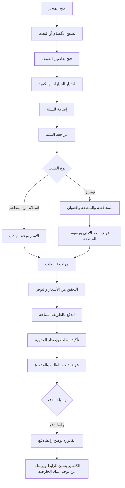

# وثيقة تصميم تجربة المستخدم والواجهات لنظام فتوش (UI/UX Design)

| الحقل | القيمة |
|---|---|
| اسم النظام | فتوش – Fatoosh Restaurant System |
| معرّف الوثيقة | FRS-UX-001 |
| الإصدار | 0.1 |
| التاريخ | 22 نوفمبر 2026 |
| الحالة | مسودة تصميم للمراجعة والاعتماد |
| المستودع | `Malek-9292/kheralden92` |
| مرجع المتطلبات | `docs/01-SRS.md` – FRS-SRS-001 |
| مرجع المعمارية | `docs/02-ARCHITECTURE.md` – FRS-ARCH-001 |
| مرجع البيانات | `docs/03-DATABASE-DESIGN.md` – FRS-DB-001 |
| التقنيات المرجعية | Laravel Livewire + Alpine.js + PWA |

> **حالة الوثيقة:** هذه مواصفات تجربة وواجهات مكتوبة، وليست تصميمًا بصريًا نهائيًا أو صفحات منفذة. لم يتم إنشاء أي كود أو قاعدة بيانات. الألوان الدقيقة والخطوط والأيقونات والقياسات والهوية البصرية تحتاج اعتمادًا قبل تحويلها إلى نماذج مرئية ثم تنفيذها.

---

## 1. الهدف والنطاق

تحدد الوثيقة بنية تجربة الاستخدام وخريطة الشاشات وتدفقات العمل الرئيسية للأنواع الثلاثة في النظام:
1. العميل عبر واجهة متجاوبة وPWA.
2. الكاشير عبر واجهة تشغيل سريعة.
3. المدير عبر لوحة إدارة شاملة.

تلتزم الواجهات بقواعد SRS: الاستلام من المطعم أو التوصيل فقط، حقول العنوان المحددة، الحد الأدنى ورسوم التوصيل حسب المنطقة، عدم فرض عنوان أو حد أدنى على الاستلام، فصل حالة الطلب عن الدفع والطباعة، وعدم كشف الوظائف غير المصرح بها.

## 2. مبادئ تجربة الاستخدام

- **العربية أولًا:** اتجاه RTL في جميع الواجهات العربية، مع دعم عرض الأرقام والرموز بصورة مقروءة.
- **Mobile-first للعميل:** تصميم يبدأ من الهاتف ثم يتوسع للشاشات الأكبر.
- **Desktop-first للكاشير والإدارة:** استغلال مساحة الشاشة مع الحفاظ على دعم الأجهزة اللوحية.
- **وضوح الحالة:** كل حالة طلب أو دفع أو طباعة تعرض نصًا واضحًا، ولا يعتمد معناها على اللون وحده.
- **تقليل الخطوات:** تقليل الانتقالات غير الضرورية في الطلب والكاشير.
- **الاتساق:** نفس أسماء المنتجات والخيارات والأسعار وقواعد الطلب في العميل والكاشير.
- **إظهار المتطلبات مبكرًا:** توضيح الحد الأدنى ورسوم التوصيل عند اختيار منطقة التوصيل، دون تعطيل مسار الاستلام.
- **حفظ السياق:** لا يفقد المستخدم بيانات النموذج عند ظهور خطأ قابل للتصحيح.
- **التأكيد قبل الأفعال الحساسة:** الإلغاء والاسترداد وإغلاق الوردية وإعادة الطباعة وتغيير الصلاحيات.
- **إمكانية الوصول:** تباين مناسب، أحجام لمس مناسبة، تركيز لوحة المفاتيح، وتسميات واضحة لحقول الإدخال.
- **التحميل والفشل:** حالات تحميل وفراغ وخطأ وانقطاع اتصال وإعادة محاولة واضحة.
- **الأمان:** لا تعرض الواجهة بيانات أو أزرارًا خارج صلاحيات المستخدم، مع بقاء التحقق الحقيقي على الخادم.

## 3. نظام التصميم (Design System) المقترح

### 3.1 الهوية البصرية

الهوية النهائية تعتمد على شعار فتوش ومواد العلامة التي يعتمدها المستخدم. توجد في سياق المشروع إشارة إلى الأخضر الفاتح كلون أساسي للعلامة، لكنه يظل اختيارًا مرجعيًا يحتاج اعتماد درجات اللون الدقيقة قبل التنفيذ.

### 3.2 الألوان الدلالية

تستخدم ألوان دلالية ثابتة على مستوى النظام، وتراجع للتباين قبل الاعتماد:

| الاستخدام | الدلالة |
|---|---|
| اللون الأساسي | الهوية والإجراءات الرئيسية |
| نجاح | عملية مكتملة أو مؤكدة |
| تحذير | يحتاج انتباهًا أو مراجعة |
| خطر | إلغاء أو خطأ أو إجراء حساس |
| معلومات | معلومة أو حالة محايدة |
| خلفية | فصل مناطق المحتوى |
| نص أساسي/ثانوي | ترتيب مستويات القراءة |

لا يتم اعتماد قيم Hex نهائية في هذه النسخة. يجب ألا يكون اللون الوسيلة الوحيدة للتمييز بين حالات الطلب أو الدفع أو الطباعة.

### 3.3 الخطوط والكتابة

- اعتماد خط عربي واضح يدعم الأوزان المختلفة والأرقام والرموز.
- تحديد خط بديل آمن في حال تعذر تحميل الخط الأساسي.
- توحيد أحجام العناوين والنصوص والتسميات ورسائل الخطأ.
- عدم استخدام نصوص طويلة داخل الأزرار.
- عرض جميع المبالغ بثلاث خانات عشرية مع العملة KWD بصورة موحدة، مثال: `1.250 د.ك`.

### 3.4 المكونات المشتركة

- زر أساسي وثانوي وخطر.
- حقول نص ورقم وهاتف وبحث.
- قوائم اختيار قابلة للبحث للمحافظات والمناطق.
- بطاقات المنتجات.
- بطاقات ملخص الطلب.
- شارات حالات الطلب والدفع والطباعة مع نصوص.
- جداول بترقيم صفحات وفرز وتصفية.
- نافذة تأكيد للإجراءات الحساسة.
- إشعارات نجاح/تحذير/خطأ.
- Skeleton/loading states.
- Empty states مع إجراء واضح.
- Pagination.
- Tabs عند وجود مجموعات متقاربة.
- Breadcrumbs في لوحة الإدارة.
- Drawer/Modal لتفاصيل سريعة دون فقد سياق القائمة.
- مكوّن رفع صور مع معاينة وحالة الرفع والتحقق من الملف.

## 4. خريطة التنقل العامة

### 4.1 واجهة العميل

- الرئيسية.
- الأقسام.
- البحث.
- تفاصيل الصنف.
- المفضلة.
- السلة.
- إتمام الطلب.
- تأكيد الطلب.
- متابعة الطلب.
- طلباتي.
- الحساب والعناوين.
- الدعم ومعلومات المطعم.

على الهاتف تستخدم قائمة تنقل مختصرة وثابتة عند الحاجة، ولا تغطي محتوى الصفحة أو زر إتمام الطلب.

### 4.2 واجهة الكاشير

قائمة جانبية أو شريط تنقل واضح يتضمن:
- لوحة الكاشير.
- الطلبات الجديدة.
- الطلبات النشطة.
- إنشاء طلب يدوي.
- سجل الطلبات.
- المطبخ.
- الطباعة والطابعة.
- العملاء.
- الوردية والصندوق.
- التقارير.
- الحساب والخروج.

تظهر العناصر وفق صلاحيات الكاشير، ولا يفترض أن جميع الكاشير يملكون الصلاحيات نفسها.

### 4.3 لوحة الإدارة

تنقل جانبي قابل للطي، مجمع حسب مجموعات العمل:
- نظرة عامة.
- الطلبات.
- القائمة والمنتجات.
- التوصيل.
- العملاء.
- المبيعات والمدفوعات.
- العروض والقسائم.
- المحتوى والمظهر.
- الكاشير والورديات.
- المطبخ والطباعة.
- المستخدمون والصلاحيات.
- الفروع.
- المخزون (بعد اعتماد نطاقه).
- التقارير والتدقيق.
- إعدادات النظام.
- النسخ الاحتياطي والمراقبة.
- إدارة الوحدات.

يجب أن تخفي القائمة ما لا يملكه المستخدم من صلاحيات، مع حماية كل صفحة وعملية على الخادم.

## 5. واجهات العميل – خريطة الشاشات

| الرمز | الشاشة | العناصر الأساسية | الإجراءات الرئيسية |
|---|---|---|---|
| C-01 | الصفحة الرئيسية | شعار، بنرات، حالة المطعم، الأقسام، الأكثر طلبًا، العروض | الانتقال لقسم أو صنف |
| C-02 | قائمة القسم | اسم القسم، المنتجات، الصور، السعر، التوفر | فتح تفاصيل الصنف |
| C-03 | البحث | حقل بحث، اقتراحات، نتائج، حالة عدم وجود نتائج | فتح صنف أو مسح البحث |
| C-04 | تفاصيل الصنف | صورة، اسم، وصف، مكونات عند انطباقها، السعر، الخيارات | اختيار الإضافات والكمية والإضافة للسلة |
| C-05 | المفضلة | الأصناف المحفوظة | فتح الصنف أو حذفه أو إضافته للسلة |
| C-06 | السلة | الأصناف، الخيارات، الكميات، الإجماليات | تعديل أو حذف أو متابعة |
| C-07 | اختيار نوع الطلب | استلام من المطعم / توصيل | اختيار المسار المناسب |
| C-08 | بيانات الاستلام | الاسم ورقم الهاتف فقط | المتابعة دون عنوان أو حد أدنى |
| C-09 | بيانات التوصيل | المحافظة، المنطقة، القطعة، الشارع، الجادة اختياري، المنزل، الدور اختياري، الشقة اختيارية | التحقق من المنطقة وحفظ العنوان |
| C-10 | مراجعة الطلب | الأصناف، خصم واحد فقط على قيمة الأصناف دون رسوم التوصيل ويظهر كسطر مستقل عند وجوده، رسوم التوصيل، الإجمالي، العنوان/الاستلام، الملاحظات | تطبيق كوبون واحد أو إزالته؛ يقبل الكوبون فقط إذا كان نوع الطلب مشمولًا في إعداداته، مع توضيح سبب الرفض عند عدم الأهلية |
| C-11 | وسيلة الدفع | وسائل الدفع المتاحة: نقدي / KNET / رابط دفع | اختيار الوسيلة فقط |
| C-12 | تأكيد الطلب | رقم الطلب، الملخص، نوع الطلب، وسيلة الدفع المختارة | عرض التأكيد والفاتورة دون حالة دفع |
| C-13 | تتبع الطلب | الحالة الحالية والتاريخ الزمني للتحديثات | تحديث العرض والعودة للطلبات |
| C-14 | طلباتي | الطلبات الحالية والسابقة | عرض التفاصيل أو إعادة الطلب وفق التوفر |
| C-15 | تفاصيل طلب سابق | لقطة الطلب والفاتورة والحالات | طلب الدعم أو إعادة الطلب عند السماح |
| C-16 | تسجيل الدخول/التسجيل | الهاتف ووسائل التحقق المعتمدة | دخول أو إنشاء حساب |
| C-17 | الملف الشخصي | الاسم والهاتف وبيانات الحساب | تعديل البيانات |
| C-18 | دفتر العناوين | قائمة العناوين وعنوان افتراضي | إضافة/تعديل/حذف |
| C-19 | الدعم والتواصل | الهاتف ووسائل التواصل والنماذج المتاحة | إرسال استفسار |
| C-20 | معلومات المطعم | العنوان وساعات العمل وسياسات التوصيل والخصوصية | الاتصال أو عرض الموقع |

هذه خريطة شاشات مقترحة لتجميع وحدات العميل الوظيفية الـ26 في SRS؛ لا تحذف أو تستبدل أي وحدة وظيفية منها.

### 5.1 بطاقة المنتج

تعرض كحد أدنى:
- الصورة الأساسية للمنتج فقط.
- الاسم.
- السعر الحالي، والسعر السابق إن كان هناك عرض معتمد.
- حالة التوفر.
- علامة الأكثر طلبًا عند انطباقها.
- زر فتح التفاصيل أو الإضافة وفق طبيعة المنتج.

لا تعرض مكونات صواني المشويات في قائمة المنتجات الرئيسية؛ تظهر داخل تفاصيل الصنف فقط.

### 5.2 تفاصيل الصنف والخيارات

- عرض الصورة الأساسية بحجم واضح، مع معرض للصور الإضافية أسفلها أو بجانبها حسب مساحة الشاشة؛ يستطيع العميل فتح الصور والتنقل بينها.
- إذا كان للصنف صورة واحدة فقط، لا تظهر عناصر تنقل إضافية للصور.
- عرض مجموعات الخيارات المطلوبة والاختيارية.
- بيان الحد الأدنى والأقصى للاختيار.
- توضيح أي تكلفة إضافية قبل الإضافة.
- إظهار الاختيارات الناقصة برسالة محددة.
- السندويتشات تستخدم الصمون افتراضيًا، والاستثناءات المحددة للصنف تظهر بوضوح.
- تحديث إجمالي الصنف فور تغيير الخيارات والكمية، مع إعادة التحقق على الخادم.

### 5.2.1 مواعيد ظهور المنتج

- يستطيع المدير إضافة أكثر من فترة ظهور يومية لكل منتج، مع تحديد وقت البداية والنهاية لكل فترة.
- تتكرر المواعيد نفسها كل يوم دون إعداد أيام أسبوع مختلفة.
- يظهر المنتج للعميل داخل الفترات المحددة ويختفي تلقائيًا خارجها.
- لا تظهر المنتجات المخفية زمنيًا في قائمة العميل أو نتائج البحث، ولا يمكن إضافتها للسلة أو تأكيدها خارج وقت ظهورها.
- يظل المنتج خاضعًا أيضًا لحالة التفعيل والتوفر؛ جدول الوقت لا يعيد تفعيل منتج عطّله المدير.
- تعرض لوحة الإدارة الفترات الحالية وتتيح إضافتها وتعديلها وحذفها.

### 5.3 السلة ونوع الطلب

- اختيار نوع الطلب بوضوح: استلام من المطعم أو توصيل فقط.
- لا يوجد خيار استلام من السيارة.
- يستطيع العميل الانتقال بين الاستلام والتوصيل قبل التأكيد.
- عند الاستلام: لا يظهر نموذج العنوان ولا حد أدنى أو رسوم توصيل.
- عند التوصيل: يظهر اختيار المنطقة وتفاصيل الحد الأدنى ورسوم التوصيل.
- إذا لم يحدد العميل المنطقة ثم حاول إضافة أول صنف، يعرض النظام توضيحًا/طلب تحديد المنطقة لمسار التوصيل فقط، ولا يمنع مسار الاستلام.
- يعاد التحقق من السعر والتوفر والحد الأدنى والرسوم عند تأكيد الطلب.

### 5.4 نموذج عنوان التوصيل

ترتيب الحقول المقترح كما يلي:
1. المحافظة.
2. المنطقة.
3. القطعة.
4. الشارع.
5. الجادة (اختياري).
6. رقم المنزل.
7. الدور (اختياري).
8. الشقة (اختياري).

تظهر المحافظة والمنطقة كقوائم اختيار مترابطة؛ اختيار المحافظة يحدّث قائمة المناطق المتاحة. لا يتم اعتماد قائمة المناطق النهائية إلا بعد مراجعة قائمة الكويت.

## 6. تدفق العميل الأساسي

لا تظهر للعميل مراحل متابعة تشغيلية بعد التأكيد. عند اختيار رابط الدفع، توضح الفاتورة وسيلة الدفع. يفتح الكاشير لوحة البنك الخارجية، وينشئ الرابط ويرسله للعميل من خلالها. لا يفتح الكاشير لوحة البنك من داخل نظام فتوش ولا يغيّر أي بيانات أو حالة دفع داخل النظام بعد الإرسال. لا يتكامل نظام فتوش تقنيًا مع لوحة البنك ولا ينشئ الرابط ولا يرسله.

## 7. واجهة الكاشير – خريطة الشاشات

| الرمز | الشاشة | العناصر الأساسية | الإجراءات الرئيسية |
|---|---|---|---|
| K-01 | تسجيل الدخول | بيانات الدخول ورسائل الأمان | بدء جلسة الكاشير |
| K-02 | فتح الوردية | رصيد افتتاحي إذا اعتمد، تأكيد المستخدم | فتح الوردية |
| K-03 | لوحة الكاشير | ملخص الطلبات، تنبيهات، حالة الوردية والطابعة | الانتقال للمهام |
| K-04 | الطلبات الجديدة | قائمة مباشرة للطلبات الجديدة | فتح الطلب ومراجعته |
| K-05 | الطلبات النشطة | الطلبات حسب الحالة والنوع | متابعة وتصفية |
| K-06 | تفاصيل الطلب | العميل، الأصناف، الخيارات، العنوان، وسيلة الدفع المختارة، سجل حالة الطلب | عرض التفاصيل وتنفيذ الإجراءات المصرح بها؛ إنشاء وإرسال رابط الدفع يتم خارج النظام من لوحة البنك |
| K-07 | إنشاء طلب يدوي | كتالوج وأقسام وبحث وسلة | إنشاء طلب من الكاشير |
| K-08 | تعديل الطلب | البنود والخيارات والأسعار وأثر التعديل | حفظ التعديل مع تسجيله |
| K-09 | اختيار نوع الطلب | استلام أو توصيل | تطبيق الحقول المناسبة |
| K-10 | بيانات التوصيل | المنطقة والعنوان والرسوم والحد الأدنى | التحقق من العنوان |
| K-11 | إدارة الاستلام | الاسم والهاتف ووقت الجاهزية عند توفره | متابعة الاستلام |
| K-12 | المطبخ | قائمة التحضير والحالة والمحطة إذا اعتمدت | إرسال ومتابعة |
| K-13 | الطباعة | مهام الطباعة والحالة والمحاولات | إعادة محاولة/إعادة طباعة بصلاحية |
| K-14 | حالة الطابعة | Print Agent والطابعة وآخر اتصال والأخطاء | فحص الحالة |
| K-15 | العملاء | البحث والتسجيل وعرض البيانات المسموح بها | اختيار أو تسجيل عميل |
| K-16 | الصندوق والوردية | المقبوضات والحركات والإجماليات | تسجيل حركة أو إغلاق الوردية |
| K-17 | التقارير | تقارير الكاشير والطلبات والوردية | التصفية والطباعة/التصدير عند اعتماده |
| K-18 | الإشعارات والنشاط | تنبيهات وسجل عمليات الكاشير | فتح الإشعار ومراجعة السجل |

هذه الشاشات تجمع الوحدات الوظيفية الأربعين في SRS، ولا تعني أن كل وحدة أصبحت صفحة منفصلة.

### 7.1 تخطيط شاشة الطلبات

- قائمة واضحة بأحدث الطلبات مع رقم الطلب والوقت والنوع والحالة والإجمالي.
- فلاتر حسب الحالة والنوع والفترة.
- تمييز الطلبات الجديدة دون الاعتماد على اللون وحده.
- تحديثات تلقائية أو شبه فورية دون فقد موضع المستخدم أو مدخلاته.
- فتح تفاصيل الطلب في لوحة جانبية أو صفحة مستقلة وفق اختبار الاستخدام.
- إظهار حالة الطباعة منفصلة عن حالة الطلب.
- إذا كانت وسيلة الدفع «رابط دفع»، تظهر هذه المعلومة بوضوح في الفاتورة.
- يعرض النظام وسيلة الدفع المختارة فقط، دون حالة أو نتيجة دفع. يفتح الكاشير لوحة البنك الخارجية وينشئ الرابط ويرسله للعميل منها؛ لا توجد داخل نظام فتوش وظيفة لإنشاء الرابط أو إرساله أو التكامل مع لوحة البنك.

### 7.2 إنشاء طلب يدوي

يستخدم الكاشير نفس كتالوج المنتجات وقواعد الخيارات والتسعير المستخدمة في واجهة العميل. يجب ألا ينشأ مسار حساب مختلف يسمح بسعر أو رسوم غير صحيحة. يحدد نوع الطلب أولًا أو في موضع واضح قبل إدخال تفاصيل العنوان.

### 7.3 الطباعة

- تعرض الشاشة حالة الطلب وحالة الطباعة في موضعين منفصلين.
- تميّز بين: منتظر، قيد الإرسال، تمت الطباعة، فشلت، تحتاج مراجعة/إعادة محاولة، وفق الحالات النهائية التي ستعتمد.
- إعادة الطباعة تتطلب صلاحية وتأكيدًا، وتسجل المستخدم والوقت والسبب عند اعتماد السياسة.
- لا يؤدي فشل الطابعة إلى إخفاء الطلب أو اعتباره فاشلًا.

## 8. لوحة الإدارة – خريطة الشاشات

| الرمز | مجموعة الشاشات | الوظائف المجمعة |
|---|---|---|
| A-01 | تسجيل الدخول والأمان | دخول المدير والجلسات وسياسات الأمان |
| A-02 | لوحة المعلومات | مؤشرات المبيعات والطلبات والتنبيهات وحالة التشغيل |
| A-03 | إدارة الطلبات | البحث والتصفية والتفاصيل والحالات والإلغاء |
| A-04 | الأقسام والمنتجات | عرض وإدارة الأقسام في شكل شجرة متعددة المستويات؛ الأقسام الرئيسية الأولية هي: أفطار الخالدية، العصائر، مشويات الخالدية، صواني مشويات، مواعين الخالدية، الساندويتشات الخفيفة، الساندويتشات الحارة والباردة، ساندويتشات الصاج. يمكن إنشاء أقسام فرعية تحت أي قسم رئيسي، وتغيير القسم الأب والترتيب والإظهار/الإخفاء. يتبع كل صنف قسمًا واحدًا فقط، ويختار المدير قسمًا واحدًا من أي مستوى عند إنشاء الصنف أو تعديله، إلى جانب إدارة الخيارات والصور والتوفر والأكثر طلبًا |
| A-05 | مناطق التوصيل | المحافظات والمناطق والتغطية والرسوم والحد الأدنى وإعدادات التوصيل |
| A-06 | العملاء | ملفات العملاء والعناوين والتقييمات |
| A-07 | الكاشير والماليات | حسابات الكاشير والمدفوعات والصندوق والتقارير المالية |
| A-08 | العروض والتسويق | القسائم والعروض والبنرات والإشعارات؛ إعداد أهلية كل كوبون: استلام فقط أو توصيل فقط أو كلاهما |
| A-09 | محتوى الموقع | النصوص والصفحات ومعلومات المطعم |
| A-10 | المظهر | الشعار والألوان والخطوط ومظهر الواجهة |
| A-11 | المستخدمون والصلاحيات | المديرون والأدوار والصلاحيات وسياسات الدخول |
| A-12 | المطبخ والطباعة | تشغيل المطبخ والطابعات والفواتير |
| A-13 | الإعدادات العامة | اللغة والعملة والمنطقة الزمنية والإعدادات العامة |
| A-14 | إدارة الوحدات | تفعيل/تعطيل آمن بعد فحص الاعتماديات |
| A-15 | قاعدة البيانات والنسخ | الحالة والنسخ الاحتياطي والاستعادة الآمنة |
| A-16 | المراقبة والأخطاء | صحة النظام والأخطاء والتكاملات والسجلات |
| A-17 | الفروع | إدارة الفروع وعملياتها عند تفعيلها |
| A-18 | المخزون | إدارة المخزون بعد اعتماد نطاقه |
| A-19 | التدقيق والامتثال | مراجعة العمليات الحساسة والسجلات |

هذه المجموعات تجمع الوحدات الإدارية الـ48 في SRS. لا يفعّل المخزون أو تعدد الفروع تشغيليًا قبل اعتماد قراراتهما.

### 8.1 جداول الإدارة

في نموذج إنشاء/تعديل الكوبون، يظهر حقل واضح لنوع الطلب المسموح: «استلام من المطعم فقط»، «توصيل فقط»، أو «الاستلام والتوصيل». يختار المدير قيمة واحدة لكل كوبون. ويظهر حقل «الحد الأدنى لقيمة الأصناف» كحقل اختياري؛ تركه فارغًا يعني عدم وجود حد أدنى خاص بالكوبون، ولا تدخل رسوم التوصيل في احتساب الحد. ويظهر حقل «الحد الأقصى لقيمة الخصم» كحقل اختياري؛ إذا تجاوز الخصم المحسوب هذا المبلغ، يطبق النظام السقف المحدد، وتركه فارغًا يعني عدم وجود سقف خاص بالكوبون. ويظهر أيضًا حقلان مستقلان: «الحد الأقصى للاستخدامات إجمالًا» و«الحد الأقصى لكل عميل»؛ يمكن ترك أي منهما فارغًا ليكون بلا حد. ويحدد المدير كذلك «تاريخ ووقت البداية» و«تاريخ ووقت النهاية» لصلاحية الكوبون. يوقف النظام قبول الكوبون تلقائيًا بعد نهاية الفترة وفق توقيت الكويت. ويتضمن النموذج حالة تفعيل واضحة تتيح للمدير إيقاف الكوبون يدويًا في أي وقت، ثم إعادة تفعيله يدويًا ما دامت فترة صلاحيته الحالية لم تنتهِ ولم يحن موعد بدايتها بعد. يظهر بوضوح ما إذا كان الكوبون فعالًا أو موقوفًا؛ وإعادة التفعيل لا تتجاوز شروط التاريخ أو حدود الاستخدام أو نوع الطلب. يُعرض سبب واضح للعميل إذا حاول استخدام كوبون خارج فترة صلاحيته أو غير صالح لنوع الطلب أو تجاوز حد الاستخدام.

يجب أن تدعم الجداول:
- البحث والتصفية.
- فرز الأعمدة المناسبة.
- Pagination.
- عرض الحالة بنص واضح.
- فتح التفاصيل دون فقد سياق البحث.
- تأكيد العمليات الحساسة.
- احترام صلاحيات العرض والتعديل والحذف/الأرشفة كلٌ على حدة.

### 8.2 نموذج إضافة/تعديل المنتج

الحقول المرئية المقترحة:
- اسم المنتج.
- القسم.
- الوصف.
- المكونات (تظهر في تفاصيل الصنف حسب سياسة العرض).
- السعر.
- السعر السابق إن كان عرضًا معتمدًا.
- لا يوجد حقل وقت تجهيز مستقل لكل صنف في الإصدار الأول.
- التوفر.
- صورة أساسية واحدة إلزامية لكل صنف؛ لا يمكن حفظ/نشر الصنف دونها.
- رفع صور إضافية اختياري، مع اختيار صورة أساسية واحدة وترتيب الصور ومعاينتها قبل الحفظ.
- مجموعات الخيارات وقواعد الاختيار، مع إمكانية إضافة مجموعة أحجام اختيارية عند انطباقها؛ لكل حجم سعر نهائي مستقل، ولا يظهر اختيار حجم للصنف الذي لا يحتوي على أحجام.
- إعداد الأحجام اختياري لكل صنف؛ عند وجود أحجام، يحدد المدير أسماءها وأسعارها النهائية، ويختار العميل الحجم قبل الإضافة للسلة. إذا لم توجد أحجام، يضاف الصنف بسعره الأساسي دون خطوة اختيار حجم.
- إعداد نوع الخبز عند انطباقه.
- ربط الصنف بمجموعة الاختيارات الثابتة المناسبة له، مع عرض الاختيارات للعميل كعناصر متعددة التحديد (Checkboxes).
- تفعيل أو إخفاء حقل الملاحظة الحرة لكل صنف على حدة؛ إذا كان مفعّلًا يظهر للعميل كحقل اختياري، وإذا لم يكن مفعّلًا لا يظهر.

**قاعدة اختيار «كامل»:** في المجموعات التي تتضمن خيار «كامل»، لا يمكن تحديده مع أي خيار آخر من المجموعة نفسها؛ عند تحديد «كامل» تُلغى بقية التحديدات، وعند تحديد خيار آخر يُلغى «كامل». بقية الخيارات يمكن تحديد أكثر من واحد منها.

**مجموعات الاختيارات الثابتة:**
**مجموعة 1 — الخيارات:** الأصناف: فلافل، مشكل، مشكل فلافل مع حمص، مشكل فلافل خبز، شاورما لحم، كباب. الاختيارات: سلطة+طحينة، سلطة فقط، طحينة فقط، طماطم فقط، بدون طماطم.
**مجموعة 2 — الخيارات:** الأصناف: حلوم، لبنة، جبن أبيض. الاختيارات: كامل، طماطم فقط، زعتر فقط، زيتون فقط، بدون طماطم، بدون زعتر، بدون زيتون.
**مجموعة 3 — الخيارات:** الأصناف: شاورما دجاج، شيش طاووق. الاختيارات: كامل، ثوم فقط، خيار مخلل فقط.
**مجموعة 4 — الخيارات:** الأصناف: نقانق، مرتديلا. الاختيارات: كامل، ك+م، ك فقط، م فقط، ك+م+بطاط، ك+بطاط، م+بطاط.

يجب إظهار معاينة لكيفية ظهور المنتج للعميل قبل النشر، مع التحقق من الحقول المطلوبة.

### 8.3 إدارة مناطق التوصيل

- اختيار المحافظة ثم المنطقة.
- إنشاء مجموعات بأسماء يحددها المدير، وإضافة/إزالة المناطق من كل مجموعة.
- تحديد حد أدنى موحد لكل مجموعة.
- إتاحة حد أدنى فردي لكل منطقة، سواء كانت خارج مجموعة أو داخل مجموعة كاستثناء يتقدم على حد المجموعة.
- إتاحة استخدام حد المجموعة دون استثناءات بترك الحد الفردي للمنطقة فارغًا.
- إظهار الحد الأدنى الفعلي المحسوب لكل منطقة بوضوح داخل لوحة الإدارة.
- تظل رسوم التوصيل محددة لكل منطقة بشكل مستقل.
- تفعيل/إيقاف التغطية لكل منطقة.
- عرض التغييرات قبل الحفظ.
- سجل من عدّل المجموعة أو رسوم المنطقة أو الحد الأدنى ووقت التعديل.
- تنبيه عند تعديل قاعدة تؤثر على طلبات جديدة.
- لا تغير القيم التاريخية المحفوظة داخل الطلبات السابقة.

## 9. حالات الواجهة القياسية

كل شاشة بيانات يجب أن تصمم للحالات التالية:

1. Loading: مؤشر تحميل أو Skeleton.
2. Success: اكتمال الإجراء ورسالة واضحة.
3. Empty: لا توجد بيانات مع سبب/إجراء تالٍ.
4. Error: رسالة مفهومة ورقم مرجعي عند الحاجة.
5. Offline/Connection Lost: تنبيه انقطاع الاتصال دون الادعاء بنجاح العملية.
6. Permission Denied: توضيح أن الصلاحية غير متاحة.
7. Validation Error: ربط رسالة الخطأ بالحقل الصحيح.
8. Conflict/Outdated Data: تنبيه عند تغير السعر أو التوفر أو حالة الطلب قبل الحفظ.
9. Pending/Unknown: عرض حالة غير محسومة عندما لا يصل رد موثوق من خدمة خارجية أو الطابعة.

لا تعرض رسالة نجاح نهائية قبل تأكيد الخادم نجاح العملية.

## 10. التصميم المتجاوب

### 10.1 العميل

- هاتف: عمود واحد، أزرار لمس واضحة، صور مناسبة، سلة يسهل الوصول إليها.
- جهاز لوحي: شبكة منتجات بعدد أعمدة مناسب للمساحة.
- سطح مكتب: شبكة أوسع مع الحفاظ على مقروئية النصوص.
- لا يثبت قياس بكسل نهائي قبل النموذج البصري واختبار الأجهزة.

### 10.2 الكاشير

- شاشة كمبيوتر: عرض الطلبات والتفاصيل مع إبقاء الإجراءات الأساسية ظاهرة.
- جهاز لوحي: تخطيط مبسط، أزرار أكبر، وتقليل الأعمدة.
- يجب ألا تعتمد الوظائف الحرجة على hover فقط؛ كل إجراء متاح باللمس ولوحة المفاتيح.

### 10.3 الإدارة

- شاشة واسعة: قائمة جانبية وجداول متعددة الأعمدة.
- جهاز لوحي: قائمة قابلة للطي وجداول قابلة للتمرير أو بطاقات.
- هاتف: دعم العرض والمراجعة والإجراءات الأساسية، مع عدم إجبار المستخدم على جدول عريض غير قابل للاستخدام.

## 11. الإشعارات والتأكيدات

- إشعار نجاح بعد تأكيد الخادم.
- تحذير قبل مغادرة نموذج به تغييرات غير محفوظة.
- تأكيد قبل الإلغاء أو الاسترداد أو حذف/أرشفة بيانات.
- تأكيد مستقل قبل إعادة الطباعة.
- تحذير عند تغيير رسوم التوصيل أو الحد الأدنى.
- لا تستخدم نوافذ تأكيد متكررة للإجراءات اليومية منخفضة المخاطر.
- لا تعرض تفاصيل حساسة في إشعارات شاشة القفل أو رسائل غير موثوقة.

## 12. الخصوصية والأمان في تجربة الواجهة

- إظهار أقل قدر من بيانات العميل اللازمة لكل دور.
- إخفاء بيانات الاتصال غير اللازمة للمطبخ.
- لا تظهر كلمات المرور أو مفاتيح التكامل أو بيانات الدفع الحساسة.
- لا تعتمد حماية الصلاحيات على إخفاء عناصر القائمة فقط.
- انتهاء الجلسة يعرض مسار إعادة دخول واضحًا دون كشف بيانات خاصة.
- عمليات الإدارة الحساسة تظهر للمستخدم المصرح فقط وتسجل في التدقيق.
- يجب دعم تكبير النص وعدم قص رسائل الخطأ أو عناوين الحقول.

## 13. إمكانية الوصول وقابلية الاستخدام

- دعم RTL حقيقي وليس مجرد محاذاة النص إلى اليمين.
- ترتيب Tab منطقي.
- حالات Focus مرئية.
- تسميات مرتبطة بالحقول ورسائل الخطأ.
- تباين ألوان مناسب.
- حجم لمس مريح على الهاتف.
- عدم استخدام اللون وحده للحالات.
- دعم قارئات الشاشة للمكونات الأساسية.
- اختبار سيناريوهات الاستخدام على هاتف فعلي وشاشة كاشير.

## 14. خطة النماذج الأولية والاعتماد

قبل كتابة الواجهات البرمجية، يتم إنشاء نماذج Wireframes بالترتيب التالي:

1. واجهة العميل: الرئيسية، تفاصيل الصنف، السلة، اختيار نوع الطلب، نموذج العنوان، المراجعة والتأكيد.
2. الكاشير: لوحة الطلبات، تفاصيل الطلب، إنشاء طلب يدوي، الطباعة، الوردية.
3. الإدارة: لوحة المعلومات، إدارة المنتجات، مناطق التوصيل، الطلبات، المستخدمون والصلاحيات.
4. نظام التصميم: الألوان والخطوط والأزرار والحقول والجداول والحالات.
5. اختبار النماذج مع المستخدم واعتمادها.
6. تحويل النماذج المعتمدة إلى مواصفات تنفيذ Livewire/Alpine.

هذه الوثيقة لا تتضمن صورًا أو نماذج مرئية فعلية. يجب عدم اعتبار الوصف النصي موافقة على الشكل النهائي.

## 15. مصفوفة قبول تجربة الاستخدام

| # | معيار القبول | طريقة التحقق |
|---:|---|---|
| 1 | يستطيع العميل التمييز بين الاستلام والتوصيل | اختبار مهمة استخدام |
| 2 | الاستلام يطلب الاسم والهاتف فقط | اختبار النموذج |
| 3 | لا يظهر حد أدنى أو رسوم توصيل للاستلام | اختبار واجهة وقواعد |
| 4 | التوصيل يوضح المنطقة والحد الأدنى والرسوم | اختبار سيناريو |
| 5 | الجادة والدور والشقة اختيارية | اختبار التحقق من الحقول |
| 6 | تفاصيل صواني المشويات تعرض المكونات، والقائمة الرئيسية لا تعرضها | اختبار قائمة وتفاصيل |
| 7 | خيارات المنتج وأسعارها واضحة قبل الإضافة | اختبار اختيار منتج |
| 8 | حالات الطلب والدفع والطباعة منفصلة ومفهومة | اختبار الكاشير |
| 9 | إعادة الطباعة تتطلب إجراءً واضحًا وصلاحية | اختبار الصلاحيات |
| 10 | الواجهة العربية RTL على الهاتف والكمبيوتر | اختبار أجهزة |
| 11 | الجداول والبحث والتصفية قابلة للاستخدام | اختبار الإدارة |
| 12 | لا تظهر وظائف غير مصرح بها | اختبار أدوار وصلاحيات |
| 13 | تظهر حالات التحميل والفراغ والخطأ والانقطاع | اختبار حالات الواجهة |
| 14 | لا تفقد النماذج المدخلات عند خطأ قابل للتصحيح | اختبار استقرار النموذج |

## 16. قرارات تحتاج اعتمادًا قبل النماذج النهائية

1. اعتماد الشعار والنسخة النهائية من الهوية البصرية.
2. درجات الأخضر الأساسية والألوان المساعدة.
3. الخط العربي.
4. صور البنرات وطريقة عرض الأقسام والمنتجات.
5. هل واجهة العميل تعرض تسجيل الدخول قبل الطلب أم تسمح بالضيف؟ سياسة الضيف مفتوحة في SRS.
6. نصوص حالات الطلب النهائية وألوانها، بعد اعتماد دورة الحالات.
7. وسائل الدفع وطريقة عرضها بعد اختيار المزود.
8. تفاصيل ساعات العمل والإغلاق والطلبات المجدولة.
9. أدوار المدير والكاشير التي تحدد ظهور الشاشات والأزرار.
10. اعتماد قالب الفاتورة وتذكرة المطبخ ومقاس الورق.
11. هل توجد محطات مطبخ وطابعات متعددة؟
12. اعتماد قائمة مناطق الكويت وأسماءها.
13. هل المخزون يظهر في لوحة الإدارة في الإصدار الأول؟
14. متى يتم تفعيل إدارة الفروع المتعددة فعليًا؟

## 17. مخرجات المرحلة التالية

بعد مراجعة واعتماد وثيقة UI/UX:
1. إعداد Wireframes فعلية للشاشات الأساسية.
2. اعتماد نظام التصميم والهوية البصرية.
3. إعداد مواصفات التفاعل لكل مكون ونموذج.
4. إعداد خطة بيئات التطوير والاختبار والإنتاج (DevOps).
5. تجهيز خطة الاختبارات وربطها بمعايير القبول.
6. لا يبدأ تنفيذ الواجهات قبل اعتماد النماذج الأساسية والقرارات المؤثرة.

## 18. سجل التعديلات

| الإصدار | التاريخ | التغيير | الحالة |
|---|---|---|---|
| 0.1 | 2026-11-22 | إنشاء مسودة تجربة المستخدم وخريطة الواجهات استنادًا إلى SRS وArchitecture وDatabase Design | بانتظار المراجعة والاعتماد |
| 0.2 | 2026-11-22 | توضيح تدفق الدفع بالرابط: الفاتورة تعرض وسيلة الدفع، والكاشير يرسل الرابط للعميل دون إرسال تلقائي من النظام | محدث للمراجعة |
| 0.3 | 2026-11-22 | تحديد أن الكاشير ينشئ الرابط ويرسله من لوحة البنك الخارجية، ولا يعدّل بيانات أو حالة الدفع داخل نظام فتوش | محدث للمراجعة |
| 0.4 | 2026-11-22 | تحديث واجهات العميل والكاشير لعرض وسيلة الدفع فقط دون حالة أو نتيجة دفع | محدث للمراجعة |
| 0.5 | 2026-11-22 | اعتماد عرض الأسعار والرسوم والخصومات والإجماليات بثلاث خانات عشرية بالدينار الكويتي | محدث للمراجعة |
| 0.6 | 2026-11-22 | اعتماد إظهار الخصم كسطر مستقل في مراجعة الطلب والفاتورة عند وجوده، دون توزيعه على الأصناف | محدث للمراجعة |
| 0.7 | 2026-11-22 | توضيح أن الخصم يحسب على قيمة الأصناف فقط ولا يشمل رسوم التوصيل | محدث للمراجعة |

---

**نهاية الوثيقة – FRS-UX-001**

## إضافة معتمدة – أداة الاستيراد الجماعي لصور المنتجات

تضيف لوحة الإدارة أداة مستقلة لاستيراد صور الأصناف دفعة واحدة، وتعمل من الكمبيوتر والهاتف. يستطيع المدير اختيار ملف ZIP أو PDF أو مجلد كامل من الجهاز. تستخرج الأداة الصور، وتطابق أسماءها مع أسماء الأصناف المعتمدة في الكتالوج، ثم تعرض شاشة مراجعة قبل الحفظ تشمل الصور التي تم التعرف عليها، والأصناف المطابقة، والملفات غير المطابقة أو المكررة أو غير الصالحة، وأي حالات ملتبسة.

- لا يتم حفظ الربط النهائي قبل مراجعة المدير وتأكيده، مع إمكانية تعديل الصنف المرتبط بكل صورة يدويًا.
- لا يتم استبدال صورة أساسية موجودة أو حذف صور سابقة تلقائيًا.
- تظهر نتيجة العملية بعد التنفيذ: عدد الصور المستوردة، والمتخطاة، وغير المطابقة، والأخطاء، مع إمكانية الرجوع إلى تفاصيل كل حالة.
- يجب أن تكون خطوات الاختيار والمعاينة والمراجعة والتأكيد قابلة للاستخدام على شاشة الهاتف والكمبيوتر.
- تظل أنواع الصور المقبولة داخليًا، وطريقة استخراج الصور من PDF، وحدود أحجام الملفات، والتخزين والضغط تفاصيل تقنية مفتوحة في DEC-026.

### توضيح مهم لطريقة المطابقة

المطابقة تكون من **محتوى الملف وبنيته** الذي يضم اسم الصنف والصورة، وليس من اسم ملف الصورة فقط. المثال المرجعي هو ZIP به مجلدات بأسماء الأقسام، وصور بأسماء الأصناف داخل كل مجلد، وملف manifest.json. لذلك يجب أن تقرأ الأداة أسماء الأقسام والأصناف والبيانات المنظمة إن وجدت وتربط كل صورة بالصنف الصحيح. وفي PDF تقرأ الأداة النصوص وأسماء الأصناف داخل الصفحات وتربطها بالصور المقابلة وفق ترتيب وتخطيط المستند؛ لا تعتبر كل صفحة صورة واحدة تلقائيًا. أي ربط غير مؤكد يظهر للمراجعة اليدوية قبل الاستيراد.

### مراجعة الأصناف الجديدة أثناء استيراد الصور

إذا احتوى الملف على اسم صنف لا يوجد في كتالوج النظام، تعرض شاشة المراجعة الصنف وصورته للمدير وتسأله صراحة هل يريد إضافته إلى المنيو أم لا. لا تتم إضافة الصنف أو حفظه كمنتج قبل موافقة المدير. إذا رفض الإضافة، يتم تخطيه وتسجيل ذلك في نتيجة الاستيراد. لا تتخذ الأداة هذا القرار نيابةً عن المدير.

- عند وجود عدة صور للصنف نفسه في الملف، تعرض شاشة المراجعة الصور ليختار المدير الصورة الأساسية، وتُعامل الصور الأخرى كصور إضافية في معرض تفاصيل الصنف.
- عند موافقة المدير على إضافة صنف جديد غير موجود في الكتالوج، تصبح الصورة المطابقة التي اكتشفت الصنف صورته الأساسية تلقائيًا. وأي صور أخرى مطابقة له تُضاف كصور إضافية، وتظهر جميعها في معاينة المراجعة قبل التأكيد النهائي.

### سلوك حفظ المنتجات ونشرها

- نموذج إضافة المنتج لا يعرض خيار «حفظ كمسودة»؛ زر الحفظ ينشئ المنتج وينشره مباشرة بعد نجاح التحقق من جميع الحقول الإلزامية.
- قبل الحفظ، يمكن عرض معاينة للمنتج كما سيظهر للعميل، لكن المعاينة لا تنشئ مسودة ولا تنشر المنتج.
- إذا فشل التحقق، تظهر رسائل واضحة بجوار الحقول ولا يتم إنشاء المنتج أو نشره.
- يظل بإمكان المدير إخفاء المنتج أو تعطيل توفره بعد نشره من أدوات الإدارة، دون الحاجة إلى مسودة.

- يظهر في إدارة كل منتج مفتاح تشغيل/إيقاف واضح.
- إيقاف المنتج يخفيه عن واجهة العميل ويمنع طلبه دون حذف بياناته.
- إعادة التشغيل تعيد إتاحته حسب فترات الظهور والتوفر المعتمدة.
- لا يُسمح بتجاوز حالة الإيقاف عبر سلة قديمة؛ يعيد الخادم التحقق عند الإضافة وعند تأكيد الطلب.

### استبعاد إدارة المخزون من لوحة الإدارة في الإطلاق الأول

- لا تعرض لوحة الإدارة وحدة مخزون أو كميات أو حركات مخزنية أو وصفات مكونات في P0.
- يعتمد التحكم في توفر الصنف على مفتاح التشغيل/الإيقاف اليدوي للمنتج فقط، ولا يرتبط بعدّاد كمية.

### حقل وصف المنتج في الإدارة والعميل

- يتوفر حقل وصف اختياري في نموذج إضافة وتعديل المنتج.
- في واجهة العميل، لا يظهر قسم الوصف إلا إذا أدخلت الإدارة نصًا فعليًا.
- عند عدم وجود وصف، تعرض بطاقة/تفاصيل المنتج الاسم والسعر والصورة وبقية الخيارات دون ترك مساحة فارغة للوصف.

### التحكم في الأقسام الفرعية

- تتيح لوحة الإدارة إدارة كاملة للأقسام الفرعية: إضافة، تعديل، إعادة تسمية، ترتيب، تفعيل، تعطيل، وحذف.
- يحدد المدير القسم الرئيسي الذي يتبعه كل قسم فرعي.
- يمكن تنظيم المنتجات داخل القسم الفرعي التابع للقسم الرئيسي.
- قبل حذف قسم فرعي مرتبط بمنتجات، يعرض النظام تنبيهًا ويطلب نقل المنتجات أو معالجة ارتباطها؛ لا يحذفها تلقائيًا.

## ملحق الواجهات والقرارات المعتمدة – 23 نوفمبر 2026

- الهوية: الأخضر الفاتح أساس بصري، ويُعرض على المالك مقترح درجات لونية وخط عربي واضح قبل تثبيت Design Tokens نهائيًا.
- شاشة العميل: المنطقة قائمة قابلة للبحث الفوري؛ بعد الاختيار تظهر رسوم التوصيل والحد الأدنى مباشرة. إذا تغير أي منهما والسلة مفتوحة، يظهر تنبيه واضح بالقيمة القديمة والجديدة ويطلب إعادة الاعتماد.
- العنوان: المنطقة والقطعة والشارع والمنزل إلزامية؛ الجادة والدور والشقة اختيارية؛ مع ملاحظات وعلامة مميزة. لا تظهر حقول العنوان لطلب الاستلام.
- الكاشير: إشعار طلب جديد داخل اللوحة مع صوت يمكن كتمه. زر وضع الطوارئ يوقف التوصيل ويُبقي الاستلام متاحًا.
- شاشة الوردية تعرض الرصيد الافتتاحي والمقبوضات والنقد المتوقع، وتطلب إدخال النقد الفعلي قبل الإغلاق، ثم تعرض الفرق.
- الفاتورة تعرض بيانات العميل والعنوان عند التوصيل، وكل بنود التسعير ووسيلة الدفع. تذكرة المطبخ تعرض رقم الطلب ونوعه ووقته والأصناف والكميات والملاحظات دون أسعار.
- إعادة الطباعة متاحة حسب الصلاحية، مع إظهار/حفظ عدد مرات الإعادة والمستخدم.
- لوحة العملاء تعرض الاسم والهاتف وعدد الطلبات وإجمالي المشتريات، مع بحث بالاسم أو الهاتف وفق الصلاحيات.
- لوحة التقارير تعرض المبيعات اليومية والشهرية والطلبات والأصناف الأكثر مبيعًا ووسائل الدفع المختارة ومبيعات الكاشير/الوردية، مع تصدير Excel/CSV.
- سجل النشاط يعرض الفاعل والتاريخ والوقت والقيم قبل وبعد للتغييرات المهمة.
- PWA قابل للتثبيت على iPhone وAndroid. في Offline تعرض الصفحات الأساسية المخزنة فقط، وتعطل أزرار الطلب والدفع والعمليات الحساسة.
- العربية أساسية مع جاهزية لإضافة الإنجليزية. البحث يدعم اللغتين ويتحمل اختلافات الهمزات والتاء المربوطة/الهاء والمسافات والأخطاء البسيطة.
- ساعات استقبال الطلبات الافتراضية 11:00 صباحًا إلى 1:00 بعد منتصف الليل، مع جدول أسبوعي ومفتاح يدوي فوري.
- الوظائف الظاهرة في P0 تشمل العروض والكوبونات والأكثر طلبًا والتواصل المباشر؛ المفضلة والتقييمات مؤجلة.

## مركز التحكم الشامل في الألوان – DEC-079

تحتوي لوحة الإدارة على شاشة «الهوية والألوان» وتوفر:
- تبويبات مستقلة لمظهر الموقع للعميل، لوحة الإدارة، لوحة الكاشير، والألوان المشتركة.
- تعديل لون الخلفية العامة وخلفيات الأقسام والبطاقات والنوافذ.
- تعديل النصوص والعناوين والنصوص الثانوية والروابط والأيقونات.
- تعديل الأزرار (أساسي/ثانوي/تعطيل/تحويم/ضغط)، الحقول والقوائم والحدود والفواصل.
- تعديل ألوان حالات النجاح والتحذير والخطأ والمعلومات والتنبيهات.
- منتقي ألوان يدعم HEX، وقوالب جاهزة، ونسخ/لصق اللون، وإعادة عنصر أو واجهة إلى اللون العام.
- معاينة حية قبل النشر، وحفظ كمسودة، ثم زر اعتماد ونشر منفصل، مع إمكانية استعادة آخر نسخة منشورة.
- يظل اللون الأخضر الفاتح خيارًا افتراضيًا قابلًا للتغيير بالكامل وليس شرطًا على بقية الصفحات.
- تعرض الواجهة تحذيرًا عند ضعف التباين أو انخفاض وضوح النص قبل السماح بالنشر.

## تخصيص لون عنصر بعينه – DEC-080

تتيح شاشة الهوية والألوان اختيار عنصر محدد من معاينة الواجهة ثم تعديل ألوانه منفردًا دون التأثير على بقية الأزرار أو العناوين أو العناصر المشابهة. تعرض الشاشة نطاق التعديل بوضوح (العنصر المحدد فقط، الواجهة، أو النظام كله) قبل الحفظ والنشر.

## استعادة كلمة المرور – DEC-082

تتضمن شاشة تسجيل الدخول خيار «نسيت كلمة المرور؟» ويكون مسار الاستعادة عبر البريد الإلكتروني فقط، دون تقديم رقم الهاتف كخيار لاستعادة كلمة المرور.

## إعدادات الحساب – DEC-083

- نموذج التسجيل: البريد الإلكتروني اختياري.
- استعادة كلمة المرور: إذا لم يكن البريد الإلكتروني موجودًا، يظهر للعميل مسار لإضافته أولًا ثم تأكيده.
- تعديل البريد: يسمح بتغيير البريد، مع خطوة تأكيد البريد الجديد.
- تعديل الهاتف: لا يظهر خيار تغيير رقم الهاتف للعميل؛ تتم العملية من خلال الإدارة.

## إعدادات حساب العميل – DEC-084

توفر واجهة حساب العميل إمكان تعديل الاسم وكلمة المرور، واستعراض الطلبات السابقة وفواتيرها، وطلب حذف الحساب، والتحكم في الموافقة الاختيارية على رسائل العروض والتسويق، وتسجيل الخروج من جميع الأجهزة. يجب توضيح أثر طلب حذف الحساب للمستخدم قبل تأكيده.

## تجربة الطلب والاستلام والتوصيل – DEC-085

- إتاحة زر «إعادة الطلب» من سجل الطلبات، مع مراجعة الأصناف والأسعار الحالية قبل التأكيد.
- إتاحة دفتر عناوين يسمح بحفظ أكثر من عنوان، والاختيار من العناوين أو إضافة عنوان جديد أثناء الطلب.
- بعد إرسال الطلب، توضح الواجهة أن التعديل غير متاح وتوجه العميل للتواصل مع المطعم.
- إضافة حقل ملاحظة عامة للطلب بجانب ملاحظات كل صنف.
- إظهار ساعات العمل وحالة استقبال الطلبات.
- واجهة الطلب لا تعرض اختيار موعد مستقبلي؛ جميع الطلبات فورية.

## واجهة الكاشير – DEC-086

- تشغيل تنبيه صوتي واضح عند وصول طلب جديد.
- إظهار إجراء رفض الطلب مع حقل إلزامي لسبب الرفض.
- توفير إعادة طباعة الفاتورة مع إظهار/تسجيل عمليات إعادة الطباعة.
- توفير البحث برقم الطلب أو رقم هاتف العميل.
- تضمين الطلبات الملغاة ضمن عرض الطلبات للكاشير.
- طلب سبب إلزامي عند تنفيذ الإلغاء.
- عدم إظهار إجراء لإعادة فتح وردية مغلقة للمشرف.

## لوحة التقارير والإحصائيات – DEC-087

تتضمن لوحة الإدارة بطاقات ملخص مبيعات اليوم ومقارنته بالأمس، ورسومًا/جداول لأعداد الطلبات حسب الساعة، وأداء كل كاشير، والأصناف الأكثر والأقل مبيعًا. تتيح مرشحات الفترات الجاهزة والفترة المخصصة، وأزرار تصدير Excel وPDF. تتضمن إعدادات التقارير التلقائية حقولًا لدورية الإرسال وعناوين بريد الإدارة، مع عرض حالة الإرسال.

## التقارير – تعديل DEC-088

تُحذف إعدادات الإرسال التلقائي للتقارير بالبريد من واجهة الإدارة. تبقى لوحة التقارير ومرشحات الفترات وأدوات عرض البيانات وتصدير Excel وPDF متاحة للاستخدام اليدوي.

## مركز الإشعارات والتنبيهات – DEC-089

توفر لوحة الإدارة سجلًا للإشعارات السابقة، مع عرض نوع الإشعار ووقته ومصدره وحالته. تتيح إعدادات الإدارة تحديد أنواع الإشعارات التي تصل إلى كل دور وظيفي. تظهر تنبيهات واضحة عند إلغاء/رفض الطلب، وانقطاع الطابعة أو فشل الطباعة، وحدوث أخطاء النظام.

## صلاحيات النسخ الاحتياطي – DEC-090

لا تعرض لوحة الإدارة إجراءً لاستعادة النسخ الاحتياطية. يمكن عرض حالة النسخ الاحتياطي وسجل العمليات للمستخدمين المخولين وفق صلاحياتهم، بينما تظل الاستعادة مسؤولية المطور فقط.

## إعدادات أمان الإدارة – DEC-091

توضح واجهة الإدارة مهلة الخمول (30 دقيقة)، وتطلب إعادة إدخال كلمة المرور عند العمليات الحساسة. تظهر رسائل واضحة عند الإيقاف المؤقت للدخول بسبب المحاولات الخاطئة. تتيح إدارة الموظفين إيقاف حساب موظف فورًا، وتوفر سجلًا قابلًا للمراجعة لدخول وخروج الموظفين وتعديلات الأسعار والمنتجات والإعدادات. لا تتضمن الواجهة إعدادًا لقائمة الأجهزة المسموح بها.

## إدارة الموظفين والصلاحيات – DEC-092

تتيح شاشة الموظفين تحديد تاريخ بداية ونهاية الحساب، وإيقافه مؤقتًا دون حذف بياناته، ونسخ صلاحيات موظف إلى آخر. تعرض الواجهة محرر صلاحيات تفصيليًا لكل عملية. تُخفى الصفحات والأقسام غير المصرح بها من قوائم الموظف، مع تسجيل محاولات الوصول المرفوضة. توفر لوحة الإدارة عرضًا للموظفين الموجودين حاليًا داخل النظام.

## محرر محتوى الموقع – DEC-093

توفر لوحة الإدارة أدوات لإعادة ترتيب أقسام المنيو والأصناف، وإظهار/إخفاء الصنف، وإدارة عدة بنرات للصفحة الرئيسية مع تحديد فترة ظهور كل منها. تتضمن الواجهة مفتاح تشغيل/إيقاف لقسم «الأكثر طلبًا»، ومحررًا لنصوص الموقع والأزرار والعناوين. يجب إتاحة معاينة واضحة للمسودة قبل نشرها للعملاء.

## إدارة العروض والخصومات والكوبونات – DEC-094

توفر لوحة الإدارة حقول بداية ونهاية الخصم، وإجراء إيقاف مؤقت دون حذف، وخيار تطبيق الخصم على قسم كامل. تتيح إعداد حد أدنى لقيمة الطلب وحد الاستخدام لكل عميل والحد الإجمالي للكوبون. تعرض واجهة العميل السعر قبل الخصم وبعده عند انطباقه. تتوفر في سجل التدقيق معلومات منشئ العرض/الكوبون وآخر من عدّله أو أوقفه وتفاصيل التغييرات.

## إعدادات الطباعة – DEC-095

توفر لوحة الإدارة إعداد اختيار الطابعة المستخدمة لفاتورة العميل وتذكرة المطبخ. تعرض واجهة الكاشير إجراءات مستقلة لإعادة طباعة فاتورة العميل وإعادة طباعة تذكرة المطبخ. تظهر هوية الكاشير على فاتورة العميل ووقت قبول الطلب على تذكرة المطبخ. تكون الطباعة التلقائية مفعلة وفق توقيت كل مستند، مع نسخة مطبخ واحدة.

## إدارة الفروع – DEC-096

تُجهز لوحة الإدارة لإدارة عدة فروع مستقبلًا، مع عرض مستقل للمنيو والأسعار والتقارير لكل فرع. يستطيع المدير الرئيسي التبديل بين الفروع وإدارتها، وتعيين الموظفين ونقلهم. لا تعرض شاشة دخول الكاشير اختيار الفرع؛ يُحمّل الفرع المرتبط بحسابه تلقائيًا. يظل الفرع المتاح عند الإطلاق هو فتوش الخالدية فقط.

## البحث وتفاصيل الأصناف – DEC-097

تتضمن واجهة العميل مربع بحث يعرض اقتراحات أثناء الكتابة، وفلاتر للسعر والأكثر طلبًا. تعرض صفحة تفاصيل الصنف المكونات وصورة واحدة فقط، وتوضح حالة «غير متاح» بوضوح على الأصناف المتوقفة. يتوفر إجراء لمشاركة رابط الصنف.

## سلة المشتريات وإتمام الطلب – DEC-098

تتيح السلة تعديل الكميات، وحذف الصنف مباشرة، وإفراغ السلة بالكامل. عند العودة للموقع تظهر السلة المحفوظة. إذا تغير سعر أي صنف، يظهر تنبيه بالسعر الجديد ويتطلب موافقة العميل قبل إتمام الطلب. عند اختيار التوصيل يظهر الحد الأدنى للتوصيل دائمًا، ويظهر ملخص الرسوم والخصومات والإجمالي قبل التأكيد. عند إغلاق المطعم، يتعطل إجراء تأكيد الطلب مع توضيح أن المطعم مغلق.

## الدفع وتسجيل التحصيل – DEC-099

في إتمام الطلب يختار العميل طريقة الدفع، وتظهر الطريقة على فاتورته. يستطيع الكاشير تعديل الطريقة بعد إرسال الطلب، مع حفظ أثر التغيير. في حالة النقد، تعرض شاشة التحصيل حقل المبلغ المستلم وتحسب الباقي تلقائيًا، مع تسجيل اسم الموظف المستلم. إذا كانت الطريقة رابط دفع، يظهر تنبيه واضح للكاشير بأن إرسال الرابط والتحقق من الدفع يتمان خارج النظام.

## إدارة المنتجات والأقسام والعمليات الجماعية – DEC-100

تتضمن واجهات إدارة المنيو إجراءات واضحة لنسخ الصنف ونسخ القسم، ونقل الصنف إلى قسم آخر. تتيح قوائم الأصناف تحديد عدة عناصر ثم تنفيذ الإجراءات الجماعية المصرح بها، ومنها الإيقاف وتعديل الأسعار بنسبة أو مبلغ. يعرض النظام سجل تغييرات الأسعار لكل صنف. لا تعرض الواجهة خيارًا لجدولة تغيير الأسعار مستقبلًا ضمن النطاق الحالي.

## الأدوار الوظيفية وسجل نشاط الموظفين – DEC-101

تتيح لوحة الإدارة إنشاء أدوار وظيفية مخصصة وتحديد صلاحياتها. توفر صفحة الموظف سجلًا تفصيليًا لنشاطه، وأداة لإنهاء جلساته فورًا. عند تعديل سعر صنف أو رسوم توصيل، يظهر حقل سبب إلزامي. تتيح إعدادات التقارير تحديد ما يمكن لكل موظف مشاهدته بحسب نوع التقرير. لا تعرض الواجهة إعدادات لأيام وساعات الدخول، ولا ترسل تنبيهًا عند كل دخول لموظف.

## إعدادات النظام العامة وهوية المطعم – DEC-102

تتضمن لوحة الإدارة صفحات لإدارة اسم المطعم والشعار وأرقام التواصل وروابط التواصل الاجتماعي، واختيار العملة واللغة الافتراضيتين. تتوفر أدوات لإيقاف استقبال الطلبات مع كتابة سبب يظهر للعميل، وإدارة رسالة إعلانية وتوقيت ظهورها، وتفعيل وضع الصيانة مع رسالة مخصصة. تعرض واجهة العميل الرسائل والحالات المناسبة، وتمنع واجهة الطلبات إتمام الطلب أثناء الإيقاف أو الصيانة. تسجل تغييرات الإعدادات مع اسم الموظف والقيم قبل وبعد.

## الإدارة المركزية وتعدد الفروع – DEC-103

تتضمن لوحة المدير الرئيسي عرضًا موحدًا لمبيعات جميع الفروع وأدوات لمقارنة الأداء، وإدارة ساعات العمل وبيانات التواصل والعنوان لكل فرع بصورة مستقلة. كما تتيح نقل الموظفين بين الفروع وإيقاف فرع مؤقتًا وتخصيص صلاحيات مدير كل فرع. تعرض لوحة مدير الفرع بيانات فرعه فقط. لا تظهر فروع تشغيلية إضافية في الإطلاق الأول؛ الفرع النشط عند الإطلاق هو فتوش الخالدية.

## سجلات الأمان وحماية البيانات والجلسات – DEC-106

تعرض لوحة المدير سجلات دخول الموظفين ومحاولات الدخول الفاشلة مع عنوان IP والتوقيت والموقع التقريبي عند توفره، وتنبيهات تكرار المحاولات الفاشلة، وسجل عمليات الحذف. عند محاولة حذف صنف أو قسم نهائيًا، تطلب الواجهة كلمة مرور المدير. لا توفر الواجهة حذفًا نهائيًا للطلبات والفواتير، بل إجراءات الإلغاء أو الأرشفة. تتيح إعدادات الجلسات تحديد مدة مستقلة للكاشير، وتوفر إجراءً لإبطال جميع جلسات الموظف عند إيقاف حسابه.

## إدارة الطابعات وإعدادات الطباعة – DEC-107

توفر لوحة الإدارة صفحة لإضافة وإدارة عدة طابعات، وتعيين طابعة لفواتير العملاء وأخرى للمطبخ، مع أدوات اختبار الاتصال وطباعة ورقة تجريبية. تعرض حالة الاتصال وتنبيهًا واضحًا عند انقطاع الطابعة، وسجلًا للعمليات الناجحة والفاشلة. لا تتضمن شاشة الكاشير اختيار الطابعة؛ وتتم إدارتها من لوحة الإدارة فقط. تطبع تذكرة المطبخ نسخة واحدة تلقائيًا، مع إعادة محاولة الطباعة عند الفشل.

## قنوات التواصل وتجربة العميل – DEC-108

تظهر أيقونة واتساب عائمة في جميع صفحات العميل، مع زر اتصال مباشر. تتوفر صفحة لإرسال الاستفسارات والشكاوى وصفحة للأسئلة الشائعة. تعرض صفحة التواصل موقع المطعم على خريطة، مع إمكانية مشاركة رابط المنيو. بعد إتمام الطلب يستطيع العميل تقييم تجربته، وتعرض لوحة الإدارة التقييمات وتتيح للمدير كتابة رد عليها.

## التسويق الموجه وبرنامج الولاء – DEC-109

لا تتضمن واجهة العميل في النطاق الحالي صفحة مستقلة للعروض النشطة أو إشعارات تسويقية للعروض الجديدة، ولا واجهات عروض/كوبونات فردية أو نقاط ولاء أو استبدال نقاط أو هدايا مرتبطة بعدد الطلبات. لا يمنع ذلك عرض الخصومات والكوبونات وفق DEC-094 أو الإشعارات التشغيلية وفق DEC-068 وDEC-089.

## إدارة الشكاوى وخدمة العملاء – DEC-110

لا تعرض لوحة الإدارة شاشة مستقلة لمتابعة الشكاوى أو تصنيفها أو تعيين مسؤولين أو تغيير حالاتها، ولا تعرض للعميل صفحة لمتابعة حالة الشكوى. تظل واجهة إرسال الاستفسارات والشكاوى العامة من موقع العميل وفق DEC-108 دون وظائف متابعة مخصصة.

## الحساب الشخصي للموظف – DEC-111

تتضمن واجهة حساب الموظف إعدادات لتغيير كلمة المرور والصورة الشخصية ورقم الهاتف، وعرض آخر تسجيل دخول وسجل الجلسات السابقة، وتفعيل التحقق بخطوتين، وتسجيل الخروج من جميع الأجهزة، واختيار لغة الواجهة. تعرض الواجهة تأكيدات واضحة للعمليات الحساسة وتلتزم بضوابط الأمان وإدارة الجلسات المعتمدة.

## تجربة الكاشير وسرعة العمل – DEC-112

تتضمن شاشة الكاشير اختصارات لوحة مفاتيح للعمليات المتكررة، وحقل بحث عن الأصناف لإضافتها مباشرة إلى الطلب. تظهر الطلبات الجديدة أعلى القائمة تلقائيًا، مع أدوات فرز حسب وقت الوصول ونوع الطلب. يستطيع الكاشير إضافة ملاحظة داخلية غير ظاهرة للعميل، وفتح عدة طلبات والتنقل بينها. تستخدم أصوات مختلفة للطلبات العادية والعاجلة، وتحفظ تفضيلات ترتيب وعرض الشاشة لكل موظف.

## أداء النظام وسرعته واستقراره – DEC-113

تحدث قائمة الطلبات لحظيًا دون إعادة تحميل الصفحة. تعرض الواجهة مؤشر تحميل عند العمليات التي تستغرق وقتًا، ورسائل خطأ واضحة تساعد الموظف على فهم المشكلة بدلًا من توقف الشاشة. تُحمّل بيانات المنيو من نسخة مؤقتة لتحسين سرعة الفتح، وتعرض الصور بعد ضغطها. تتضمن لوحة الإدارة مؤشرات لمراقبة الأداء واستهلاك الموارد، وتنبيهات عند البطء أو ارتفاع الاستهلاك، وصفحة حالة للخدمات الأساسية وقاعدة البيانات والطباعة.

## ضمان النسخ الاحتياطي واستعادة النظام – DEC-114

تعرض لوحة الإدارة آخر نسخة احتياطية ووقت نجاحها وحالة اختبار سلامتها، وتعرض تنبيهًا عند فشل النسخ أو اقتراب مساحة التخزين من الامتلاء. تظهر معلومات عمليات الاستعادة مع اسم المطور والتوقيت في سجل قابل للمراجعة. أثناء استعادة النظام، تظهر حالة صيانة واضحة ويُوقف استقبال الطلبات الجديدة حتى انتهاء الاستعادة والتحقق من عودة الخدمات.

## البحث والتصفية داخل لوحة الإدارة – DEC-115

تتضمن لوحة الإدارة حقل بحث عام للوصول إلى الأقسام والوظائف، وصفحات بحث مخصصة للطلبات والموظفين وسجلات التعديلات. توفر أدوات تصفية حسب التاريخ ونوع الطلب والحالة، مع إمكانية حفظ الفلاتر المتكررة وتصدير النتائج إلى Excel. لا تعرض نتائج البحث أو التصدير إلا البيانات المسموح بها وفق صلاحيات الموظف.

## بيئات التطوير والاختبار والنشر – DEC-116

تعرض لوحة الإدارة سجل التحديثات البرمجية وتوقيت تثبيتها ونتائج النشر. يجب أن يكون اعتماد المدير الرئيسي واضحًا وصريحًا قبل النشر إلى النظام الرسمي. تعرض الواجهة نتائج الاختبارات التلقائية، ولا تتيح إكمال النشر إذا فشلت الاختبارات الأساسية. توفر معلومات الإصدارات السابقة وإجراء الرجوع إلى إصدار سابق وفق الصلاحيات، وترسل إشعارًا للمدير عند نجاح النشر أو فشله. تبقى بيئة الاختبار منفصلة عن النظام الرسمي.

## ملحق مواءمة الواجهات مع القرارات الأحدث
- واجهة التقييم تتيح للعميل تقييم تجربته بعد اكتمال الطلب، وتعرض رد الإدارة عند وجوده (DEC-108).
- لا تنشأ شاشة مفضلة في المرحلة الحالية، ولا وحدة مستقلة لإدارة الشكاوى أو تذاكر متابعتها (DEC-109/110).
- إعدادات الطباعة للمدير فقط، وتتيح تعريف عدة طابعات وتحديد طابعة لفاتورة العميل وأخرى للمطبخ، مع اختبار الاتصال والطباعة التجريبية (DEC-107).
- لا تعرض واجهات تشغيلية للمخزون أو الموردين أو المشتريات أو المصروفات في المرحلة الحالية (DEC-104/105).
- لا تعرض واجهة استعادة النسخ الاحتياطية؛ الاستعادة للمطور فقط خارج لوحة الإدارة (DEC-090).
- يظهر سجل تحديثات النظام ونتائج الاختبارات واعتماد النشر للمدير المخول، مع إشعار النجاح أو الفشل (DEC-116).
