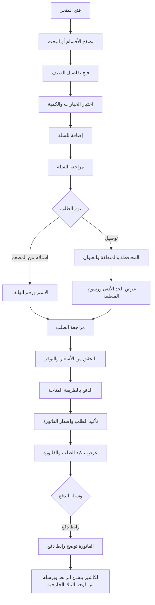

# وثيقة تصميم تجربة المستخدم والواجهات لنظام فتوش (UI/UX Design)

| الحقل | القيمة |
|---|---|
| اسم النظام | فتوش – Fatoosh Restaurant System |
| معرّف الوثيقة | FRS-UX-001 |
| الإصدار | 0.1 |
| التاريخ | 22 نوفمبر 2026 |
| الحالة | مسودة تصميم للمراجعة والاعتماد |
| المستودع | `Malek-9292/kheralden92` |
| مرجع المتطلبات | `docs/01-SRS.md` – FRS-SRS-001 |
| مرجع المعمارية | `docs/02-ARCHITECTURE.md` – FRS-ARCH-001 |
| مرجع البيانات | `docs/03-DATABASE-DESIGN.md` – FRS-DB-001 |
| التقنيات المرجعية | Laravel Livewire + Alpine.js + PWA |

> **حالة الوثيقة:** هذه مواصفات تجربة وواجهات مكتوبة، وليست تصميمًا بصريًا نهائيًا أو صفحات منفذة. لم يتم إنشاء أي كود أو قاعدة بيانات. الألوان الدقيقة والخطوط والأيقونات والقياسات والهوية البصرية تحتاج اعتمادًا قبل تحويلها إلى نماذج مرئية ثم تنفيذها.

---

## 1. الهدف والنطاق

تحدد الوثيقة بنية تجربة الاستخدام وخريطة الشاشات وتدفقات العمل الرئيسية للأنواع الثلاثة في النظام:
1. العميل عبر واجهة متجاوبة وPWA.
2. الكاشير عبر واجهة تشغيل سريعة.
3. المدير عبر لوحة إدارة شاملة.

تلتزم الواجهات بقواعد SRS: الاستلام من المطعم أو التوصيل فقط، حقول العنوان المحددة، الحد الأدنى ورسوم التوصيل حسب المنطقة، عدم فرض عنوان أو حد أدنى على الاستلام، فصل حالة الطلب عن الدفع والطباعة، وعدم كشف الوظائف غير المصرح بها.

## 2. مبادئ تجربة الاستخدام

- **العربية أولًا:** اتجاه RTL في جميع الواجهات العربية، مع دعم عرض الأرقام والرموز بصورة مقروءة.
- **Mobile-first للعميل:** تصميم يبدأ من الهاتف ثم يتوسع للشاشات الأكبر.
- **Desktop-first للكاشير والإدارة:** استغلال مساحة الشاشة مع الحفاظ على دعم الأجهزة اللوحية.
- **وضوح الحالة:** كل حالة طلب أو دفع أو طباعة تعرض نصًا واضحًا، ولا يعتمد معناها على اللون وحده.
- **تقليل الخطوات:** تقليل الانتقالات غير الضرورية في الطلب والكاشير.
- **الاتساق:** نفس أسماء المنتجات والخيارات والأسعار وقواعد الطلب في العميل والكاشير.
- **إظهار المتطلبات مبكرًا:** توضيح الحد الأدنى ورسوم التوصيل عند اختيار منطقة التوصيل، دون تعطيل مسار الاستلام.
- **حفظ السياق:** لا يفقد المستخدم بيانات النموذج عند ظهور خطأ قابل للتصحيح.
- **التأكيد قبل الأفعال الحساسة:** الإلغاء والاسترداد وإغلاق الوردية وإعادة الطباعة وتغيير الصلاحيات.
- **إمكانية الوصول:** تباين مناسب، أحجام لمس مناسبة، تركيز لوحة المفاتيح، وتسميات واضحة لحقول الإدخال.
- **التحميل والفشل:** حالات تحميل وفراغ وخطأ وانقطاع اتصال وإعادة محاولة واضحة.
- **الأمان:** لا تعرض الواجهة بيانات أو أزرارًا خارج صلاحيات المستخدم، مع بقاء التحقق الحقيقي على الخادم.

## 3. نظام التصميم (Design System) المقترح

### 3.1 الهوية البصرية

الهوية النهائية تعتمد على شعار فتوش ومواد العلامة التي يعتمدها المستخدم. توجد في سياق المشروع إشارة إلى الأخضر الفاتح كلون أساسي للعلامة، لكنه يظل اختيارًا مرجعيًا يحتاج اعتماد درجات اللون الدقيقة قبل التنفيذ.

### 3.2 الألوان الدلالية

تستخدم ألوان دلالية ثابتة على مستوى النظام، وتراجع للتباين قبل الاعتماد:

| الاستخدام | الدلالة |
|---|---|
| اللون الأساسي | الهوية والإجراءات الرئيسية |
| نجاح | عملية مكتملة أو مؤكدة |
| تحذير | يحتاج انتباهًا أو مراجعة |
| خطر | إلغاء أو خطأ أو إجراء حساس |
| معلومات | معلومة أو حالة محايدة |
| خلفية | فصل مناطق المحتوى |
| نص أساسي/ثانوي | ترتيب مستويات القراءة |

لا يتم اعتماد قيم Hex نهائية في هذه النسخة. يجب ألا يكون اللون الوسيلة الوحيدة للتمييز بين حالات الطلب أو الدفع أو الطباعة.

### 3.3 الخطوط والكتابة

- اعتماد خط عربي واضح يدعم الأوزان المختلفة والأرقام والرموز.
- تحديد خط بديل آمن في حال تعذر تحميل الخط الأساسي.
- توحيد أحجام العناوين والنصوص والتسميات ورسائل الخطأ.
- عدم استخدام نصوص طويلة داخل الأزرار.
- عرض جميع المبالغ بثلاث خانات عشرية مع العملة KWD بصورة موحدة، مثال: `1.250 د.ك`.

### 3.4 المكونات المشتركة

- زر أساسي وثانوي وخطر.
- حقول نص ورقم وهاتف وبحث.
- قوائم اختيار قابلة للبحث للمحافظات والمناطق.
- بطاقات المنتجات.
- بطاقات ملخص الطلب.
- شارات حالات الطلب والدفع والطباعة مع نصوص.
- جداول بترقيم صفحات وفرز وتصفية.
- نافذة تأكيد للإجراءات الحساسة.
- إشعارات نجاح/تحذير/خطأ.
- Skeleton/loading states.
- Empty states مع إجراء واضح.
- Pagination.
- Tabs عند وجود مجموعات متقاربة.
- Breadcrumbs في لوحة الإدارة.
- Drawer/Modal لتفاصيل سريعة دون فقد سياق القائمة.
- مكوّن رفع صور مع معاينة وحالة الرفع والتحقق من الملف.

## 4. خريطة التنقل العامة

### 4.1 واجهة العميل

- الرئيسية.
- الأقسام.
- البحث.
- تفاصيل الصنف.
- المفضلة.
- السلة.
- إتمام الطلب.
- تأكيد الطلب.
- متابعة الطلب.
- طلباتي.
- الحساب والعناوين.
- الدعم ومعلومات المطعم.

على الهاتف تستخدم قائمة تنقل مختصرة وثابتة عند الحاجة، ولا تغطي محتوى الصفحة أو زر إتمام الطلب.

### 4.2 واجهة الكاشير

قائمة جانبية أو شريط تنقل واضح يتضمن:
- لوحة الكاشير.
- الطلبات الجديدة.
- الطلبات النشطة.
- إنشاء طلب يدوي.
- سجل الطلبات.
- المطبخ.
- الطباعة والطابعة.
- العملاء.
- الوردية والصندوق.
- التقارير.
- الحساب والخروج.

تظهر العناصر وفق صلاحيات الكاشير، ولا يفترض أن جميع الكاشير يملكون الصلاحيات نفسها.

### 4.3 لوحة الإدارة

تنقل جانبي قابل للطي، مجمع حسب مجموعات العمل:
- نظرة عامة.
- الطلبات.
- القائمة والمنتجات.
- التوصيل.
- العملاء.
- المبيعات والمدفوعات.
- العروض والقسائم.
- المحتوى والمظهر.
- الكاشير والورديات.
- المطبخ والطباعة.
- المستخدمون والصلاحيات.
- الفروع.
- المخزون (بعد اعتماد نطاقه).
- التقارير والتدقيق.
- إعدادات النظام.
- النسخ الاحتياطي والمراقبة.
- إدارة الوحدات.

يجب أن تخفي القائمة ما لا يملكه المستخدم من صلاحيات، مع حماية كل صفحة وعملية على الخادم.

## 5. واجهات العميل – خريطة الشاشات

| الرمز | الشاشة | العناصر الأساسية | الإجراءات الرئيسية |
|---|---|---|---|
| C-01 | الصفحة الرئيسية | شعار، بنرات، حالة المطعم، الأقسام، الأكثر طلبًا، العروض | الانتقال لقسم أو صنف |
| C-02 | قائمة القسم | اسم القسم، المنتجات، الصور، السعر، التوفر | فتح تفاصيل الصنف |
| C-03 | البحث | حقل بحث، اقتراحات، نتائج، حالة عدم وجود نتائج | فتح صنف أو مسح البحث |
| C-04 | تفاصيل الصنف | صورة، اسم، وصف، مكونات عند انطباقها، السعر، الخيارات | اختيار الإضافات والكمية والإضافة للسلة |
| C-05 | المفضلة | الأصناف المحفوظة | فتح الصنف أو حذفه أو إضافته للسلة |
| C-06 | السلة | الأصناف، الخيارات، الكميات، الإجماليات | تعديل أو حذف أو متابعة |
| C-07 | اختيار نوع الطلب | استلام من المطعم / توصيل | اختيار المسار المناسب |
| C-08 | بيانات الاستلام | الاسم ورقم الهاتف فقط | المتابعة دون عنوان أو حد أدنى |
| C-09 | بيانات التوصيل | المحافظة، المنطقة، القطعة، الشارع، الجادة اختياري، المنزل، الدور اختياري، الشقة اختيارية | التحقق من المنطقة وحفظ العنوان |
| C-10 | مراجعة الطلب | الأصناف، خصم واحد فقط على قيمة الأصناف دون رسوم التوصيل ويظهر كسطر مستقل عند وجوده، رسوم التوصيل، الإجمالي، العنوان/الاستلام، الملاحظات | تطبيق كوبون واحد أو إزالته؛ يقبل الكوبون فقط إذا كان نوع الطلب مشمولًا في إعداداته، مع توضيح سبب الرفض عند عدم الأهلية |
| C-11 | وسيلة الدفع | وسائل الدفع المتاحة: نقدي / KNET / رابط دفع | اختيار الوسيلة فقط |
| C-12 | تأكيد الطلب | رقم الطلب، الملخص، نوع الطلب، وسيلة الدفع المختارة | عرض التأكيد والفاتورة دون حالة دفع |
| C-13 | تتبع الطلب | الحالة الحالية والتاريخ الزمني للتحديثات | تحديث العرض والعودة للطلبات |
| C-14 | طلباتي | الطلبات الحالية والسابقة | عرض التفاصيل أو إعادة الطلب وفق التوفر |
| C-15 | تفاصيل طلب سابق | لقطة الطلب والفاتورة والحالات | طلب الدعم أو إعادة الطلب عند السماح |
| C-16 | تسجيل الدخول/التسجيل | الهاتف ووسائل التحقق المعتمدة | دخول أو إنشاء حساب |
| C-17 | الملف الشخصي | الاسم والهاتف وبيانات الحساب | تعديل البيانات |
| C-18 | دفتر العناوين | قائمة العناوين وعنوان افتراضي | إضافة/تعديل/حذف |
| C-19 | الدعم والتواصل | الهاتف ووسائل التواصل والنماذج المتاحة | إرسال استفسار |
| C-20 | معلومات المطعم | العنوان وساعات العمل وسياسات التوصيل والخصوصية | الاتصال أو عرض الموقع |

هذه خريطة شاشات مقترحة لتجميع وحدات العميل الوظيفية الـ26 في SRS؛ لا تحذف أو تستبدل أي وحدة وظيفية منها.

### 5.1 بطاقة المنتج

تعرض كحد أدنى:
- صورة المنتج.
- الاسم.
- السعر الحالي، والسعر السابق إن كان هناك عرض معتمد.
- حالة التوفر.
- علامة الأكثر طلبًا عند انطباقها.
- زر فتح التفاصيل أو الإضافة وفق طبيعة المنتج.

لا تعرض مكونات صواني المشويات في قائمة المنتجات الرئيسية؛ تظهر داخل تفاصيل الصنف فقط.

### 5.2 تفاصيل الصنف والخيارات

- عرض مجموعات الخيارات المطلوبة والاختيارية.
- بيان الحد الأدنى والأقصى للاختيار.
- توضيح أي تكلفة إضافية قبل الإضافة.
- إظهار الاختيارات الناقصة برسالة محددة.
- السندويتشات تستخدم الصمون افتراضيًا، والاستثناءات المحددة للصنف تظهر بوضوح.
- تحديث إجمالي الصنف فور تغيير الخيارات والكمية، مع إعادة التحقق على الخادم.

### 5.2.1 مواعيد ظهور المنتج

- يستطيع المدير إضافة أكثر من فترة ظهور يومية لكل منتج، مع تحديد وقت البداية والنهاية لكل فترة.
- تتكرر المواعيد نفسها كل يوم دون إعداد أيام أسبوع مختلفة.
- يظهر المنتج للعميل داخل الفترات المحددة ويختفي تلقائيًا خارجها.
- لا تظهر المنتجات المخفية زمنيًا في قائمة العميل أو نتائج البحث، ولا يمكن إضافتها للسلة أو تأكيدها خارج وقت ظهورها.
- يظل المنتج خاضعًا أيضًا لحالة التفعيل والتوفر؛ جدول الوقت لا يعيد تفعيل منتج عطّله المدير.
- تعرض لوحة الإدارة الفترات الحالية وتتيح إضافتها وتعديلها وحذفها.

### 5.3 السلة ونوع الطلب

- اختيار نوع الطلب بوضوح: استلام من المطعم أو توصيل فقط.
- لا يوجد خيار استلام من السيارة.
- يستطيع العميل الانتقال بين الاستلام والتوصيل قبل التأكيد.
- عند الاستلام: لا يظهر نموذج العنوان ولا حد أدنى أو رسوم توصيل.
- عند التوصيل: يظهر اختيار المنطقة وتفاصيل الحد الأدنى ورسوم التوصيل.
- إذا لم يحدد العميل المنطقة ثم حاول إضافة أول صنف، يعرض النظام توضيحًا/طلب تحديد المنطقة لمسار التوصيل فقط، ولا يمنع مسار الاستلام.
- يعاد التحقق من السعر والتوفر والحد الأدنى والرسوم عند تأكيد الطلب.

### 5.4 نموذج عنوان التوصيل

ترتيب الحقول المقترح كما يلي:
1. المحافظة.
2. المنطقة.
3. القطعة.
4. الشارع.
5. الجادة (اختياري).
6. رقم المنزل.
7. الدور (اختياري).
8. الشقة (اختياري).

تظهر المحافظة والمنطقة كقوائم اختيار مترابطة؛ اختيار المحافظة يحدّث قائمة المناطق المتاحة. لا يتم اعتماد قائمة المناطق النهائية إلا بعد مراجعة قائمة الكويت.

## 6. تدفق العميل الأساسي

لا تظهر للعميل مراحل متابعة تشغيلية بعد التأكيد. عند اختيار رابط الدفع، توضح الفاتورة وسيلة الدفع. يفتح الكاشير لوحة البنك الخارجية، وينشئ الرابط ويرسله للعميل من خلالها. لا يفتح الكاشير لوحة البنك من داخل نظام فتوش ولا يغيّر أي بيانات أو حالة دفع داخل النظام بعد الإرسال. لا يتكامل نظام فتوش تقنيًا مع لوحة البنك ولا ينشئ الرابط ولا يرسله.

## 7. واجهة الكاشير – خريطة الشاشات

| الرمز | الشاشة | العناصر الأساسية | الإجراءات الرئيسية |
|---|---|---|---|
| K-01 | تسجيل الدخول | بيانات الدخول ورسائل الأمان | بدء جلسة الكاشير |
| K-02 | فتح الوردية | رصيد افتتاحي إذا اعتمد، تأكيد المستخدم | فتح الوردية |
| K-03 | لوحة الكاشير | ملخص الطلبات، تنبيهات، حالة الوردية والطابعة | الانتقال للمهام |
| K-04 | الطلبات الجديدة | قائمة مباشرة للطلبات الجديدة | فتح الطلب ومراجعته |
| K-05 | الطلبات النشطة | الطلبات حسب الحالة والنوع | متابعة وتصفية |
| K-06 | تفاصيل الطلب | العميل، الأصناف، الخيارات، العنوان، وسيلة الدفع المختارة، سجل حالة الطلب | عرض التفاصيل وتنفيذ الإجراءات المصرح بها؛ إنشاء وإرسال رابط الدفع يتم خارج النظام من لوحة البنك |
| K-07 | إنشاء طلب يدوي | كتالوج وأقسام وبحث وسلة | إنشاء طلب من الكاشير |
| K-08 | تعديل الطلب | البنود والخيارات والأسعار وأثر التعديل | حفظ التعديل مع تسجيله |
| K-09 | اختيار نوع الطلب | استلام أو توصيل | تطبيق الحقول المناسبة |
| K-10 | بيانات التوصيل | المنطقة والعنوان والرسوم والحد الأدنى | التحقق من العنوان |
| K-11 | إدارة الاستلام | الاسم والهاتف ووقت الجاهزية عند توفره | متابعة الاستلام |
| K-12 | المطبخ | قائمة التحضير والحالة والمحطة إذا اعتمدت | إرسال ومتابعة |
| K-13 | الطباعة | مهام الطباعة والحالة والمحاولات | إعادة محاولة/إعادة طباعة بصلاحية |
| K-14 | حالة الطابعة | Print Agent والطابعة وآخر اتصال والأخطاء | فحص الحالة |
| K-15 | العملاء | البحث والتسجيل وعرض البيانات المسموح بها | اختيار أو تسجيل عميل |
| K-16 | الصندوق والوردية | المقبوضات والحركات والإجماليات | تسجيل حركة أو إغلاق الوردية |
| K-17 | التقارير | تقارير الكاشير والطلبات والوردية | التصفية والطباعة/التصدير عند اعتماده |
| K-18 | الإشعارات والنشاط | تنبيهات وسجل عمليات الكاشير | فتح الإشعار ومراجعة السجل |

هذه الشاشات تجمع الوحدات الوظيفية الأربعين في SRS، ولا تعني أن كل وحدة أصبحت صفحة منفصلة.

### 7.1 تخطيط شاشة الطلبات

- قائمة واضحة بأحدث الطلبات مع رقم الطلب والوقت والنوع والحالة والإجمالي.
- فلاتر حسب الحالة والنوع والفترة.
- تمييز الطلبات الجديدة دون الاعتماد على اللون وحده.
- تحديثات تلقائية أو شبه فورية دون فقد موضع المستخدم أو مدخلاته.
- فتح تفاصيل الطلب في لوحة جانبية أو صفحة مستقلة وفق اختبار الاستخدام.
- إظهار حالة الطباعة منفصلة عن حالة الطلب.
- إذا كانت وسيلة الدفع «رابط دفع»، تظهر هذه المعلومة بوضوح في الفاتورة.
- يعرض النظام وسيلة الدفع المختارة فقط، دون حالة أو نتيجة دفع. يفتح الكاشير لوحة البنك الخارجية وينشئ الرابط ويرسله للعميل منها؛ لا توجد داخل نظام فتوش وظيفة لإنشاء الرابط أو إرساله أو التكامل مع لوحة البنك.

### 7.2 إنشاء طلب يدوي

يستخدم الكاشير نفس كتالوج المنتجات وقواعد الخيارات والتسعير المستخدمة في واجهة العميل. يجب ألا ينشأ مسار حساب مختلف يسمح بسعر أو رسوم غير صحيحة. يحدد نوع الطلب أولًا أو في موضع واضح قبل إدخال تفاصيل العنوان.

### 7.3 الطباعة

- تعرض الشاشة حالة الطلب وحالة الطباعة في موضعين منفصلين.
- تميّز بين: منتظر، قيد الإرسال، تمت الطباعة، فشلت، تحتاج مراجعة/إعادة محاولة، وفق الحالات النهائية التي ستعتمد.
- إعادة الطباعة تتطلب صلاحية وتأكيدًا، وتسجل المستخدم والوقت والسبب عند اعتماد السياسة.
- لا يؤدي فشل الطابعة إلى إخفاء الطلب أو اعتباره فاشلًا.

## 8. لوحة الإدارة – خريطة الشاشات

| الرمز | مجموعة الشاشات | الوظائف المجمعة |
|---|---|---|
| A-01 | تسجيل الدخول والأمان | دخول المدير والجلسات وسياسات الأمان |
| A-02 | لوحة المعلومات | مؤشرات المبيعات والطلبات والتنبيهات وحالة التشغيل |
| A-03 | إدارة الطلبات | البحث والتصفية والتفاصيل والحالات والإلغاء |
| A-04 | الأقسام والمنتجات | الأقسام والمنتجات والخيارات والصور والتوفر والأكثر طلبًا |
| A-05 | مناطق التوصيل | المحافظات والمناطق والتغطية والرسوم والحد الأدنى وإعدادات التوصيل |
| A-06 | العملاء | ملفات العملاء والعناوين والتقييمات |
| A-07 | الكاشير والماليات | حسابات الكاشير والمدفوعات والصندوق والتقارير المالية |
| A-08 | العروض والتسويق | القسائم والعروض والبنرات والإشعارات؛ إعداد أهلية كل كوبون: استلام فقط أو توصيل فقط أو كلاهما |
| A-09 | محتوى الموقع | النصوص والصفحات ومعلومات المطعم |
| A-10 | المظهر | الشعار والألوان والخطوط ومظهر الواجهة |
| A-11 | المستخدمون والصلاحيات | المديرون والأدوار والصلاحيات وسياسات الدخول |
| A-12 | المطبخ والطباعة | تشغيل المطبخ والطابعات والفواتير |
| A-13 | الإعدادات العامة | اللغة والعملة والمنطقة الزمنية والإعدادات العامة |
| A-14 | إدارة الوحدات | تفعيل/تعطيل آمن بعد فحص الاعتماديات |
| A-15 | قاعدة البيانات والنسخ | الحالة والنسخ الاحتياطي والاستعادة الآمنة |
| A-16 | المراقبة والأخطاء | صحة النظام والأخطاء والتكاملات والسجلات |
| A-17 | الفروع | إدارة الفروع وعملياتها عند تفعيلها |
| A-18 | المخزون | إدارة المخزون بعد اعتماد نطاقه |
| A-19 | التدقيق والامتثال | مراجعة العمليات الحساسة والسجلات |

هذه المجموعات تجمع الوحدات الإدارية الـ48 في SRS. لا يفعّل المخزون أو تعدد الفروع تشغيليًا قبل اعتماد قراراتهما.

### 8.1 جداول الإدارة

في نموذج إنشاء/تعديل الكوبون، يظهر حقل واضح لنوع الطلب المسموح: «استلام من المطعم فقط»، «توصيل فقط»، أو «الاستلام والتوصيل». يختار المدير قيمة واحدة لكل كوبون. ويظهر أيضًا حقلان مستقلان: «الحد الأقصى للاستخدامات إجمالًا» و«الحد الأقصى لكل عميل»؛ يمكن ترك أي منهما فارغًا ليكون بلا حد. ويحدد المدير كذلك «تاريخ ووقت البداية» و«تاريخ ووقت النهاية» لصلاحية الكوبون. يوقف النظام قبول الكوبون تلقائيًا بعد نهاية الفترة وفق توقيت الكويت. ويتضمن النموذج حالة تفعيل واضحة تتيح للمدير إيقاف الكوبون يدويًا في أي وقت، حتى داخل فترة صلاحيته؛ ويظهر أن الكوبون موقوف ولا يقبله النظام بعد ذلك. يُعرض سبب واضح للعميل إذا حاول استخدام كوبون خارج فترة صلاحيته أو غير صالح لنوع الطلب أو تجاوز حد الاستخدام.

يجب أن تدعم الجداول:
- البحث والتصفية.
- فرز الأعمدة المناسبة.
- Pagination.
- عرض الحالة بنص واضح.
- فتح التفاصيل دون فقد سياق البحث.
- تأكيد العمليات الحساسة.
- احترام صلاحيات العرض والتعديل والحذف/الأرشفة كلٌ على حدة.

### 8.2 نموذج إضافة/تعديل المنتج

الحقول المرئية المقترحة:
- اسم المنتج.
- القسم.
- الوصف.
- المكونات (تظهر في تفاصيل الصنف حسب سياسة العرض).
- السعر.
- السعر السابق إن كان عرضًا معتمدًا.
- وقت التجهيز إذا تم استخدامه.
- التوفر.
- صور المنتج وترتيبها والصورة الأساسية.
- مجموعات الخيارات وقواعد الاختيار.
- إعداد نوع الخبز عند انطباقه.

يجب إظهار معاينة لكيفية ظهور المنتج للعميل قبل النشر، مع التحقق من الحقول المطلوبة.

### 8.3 إدارة مناطق التوصيل

- اختيار المحافظة ثم المنطقة.
- إنشاء مجموعات بأسماء يحددها المدير، وإضافة/إزالة المناطق من كل مجموعة.
- تحديد حد أدنى موحد لكل مجموعة.
- إتاحة حد أدنى فردي لكل منطقة، سواء كانت خارج مجموعة أو داخل مجموعة كاستثناء يتقدم على حد المجموعة.
- إتاحة استخدام حد المجموعة دون استثناءات بترك الحد الفردي للمنطقة فارغًا.
- إظهار الحد الأدنى الفعلي المحسوب لكل منطقة بوضوح داخل لوحة الإدارة.
- تظل رسوم التوصيل محددة لكل منطقة بشكل مستقل.
- تفعيل/إيقاف التغطية لكل منطقة.
- عرض التغييرات قبل الحفظ.
- سجل من عدّل المجموعة أو رسوم المنطقة أو الحد الأدنى ووقت التعديل.
- تنبيه عند تعديل قاعدة تؤثر على طلبات جديدة.
- لا تغير القيم التاريخية المحفوظة داخل الطلبات السابقة.

## 9. حالات الواجهة القياسية

كل شاشة بيانات يجب أن تصمم للحالات التالية:

1. Loading: مؤشر تحميل أو Skeleton.
2. Success: اكتمال الإجراء ورسالة واضحة.
3. Empty: لا توجد بيانات مع سبب/إجراء تالٍ.
4. Error: رسالة مفهومة ورقم مرجعي عند الحاجة.
5. Offline/Connection Lost: تنبيه انقطاع الاتصال دون الادعاء بنجاح العملية.
6. Permission Denied: توضيح أن الصلاحية غير متاحة.
7. Validation Error: ربط رسالة الخطأ بالحقل الصحيح.
8. Conflict/Outdated Data: تنبيه عند تغير السعر أو التوفر أو حالة الطلب قبل الحفظ.
9. Pending/Unknown: عرض حالة غير محسومة عندما لا يصل رد موثوق من خدمة خارجية أو الطابعة.

لا تعرض رسالة نجاح نهائية قبل تأكيد الخادم نجاح العملية.

## 10. التصميم المتجاوب

### 10.1 العميل

- هاتف: عمود واحد، أزرار لمس واضحة، صور مناسبة، سلة يسهل الوصول إليها.
- جهاز لوحي: شبكة منتجات بعدد أعمدة مناسب للمساحة.
- سطح مكتب: شبكة أوسع مع الحفاظ على مقروئية النصوص.
- لا يثبت قياس بكسل نهائي قبل النموذج البصري واختبار الأجهزة.

### 10.2 الكاشير

- شاشة كمبيوتر: عرض الطلبات والتفاصيل مع إبقاء الإجراءات الأساسية ظاهرة.
- جهاز لوحي: تخطيط مبسط، أزرار أكبر، وتقليل الأعمدة.
- يجب ألا تعتمد الوظائف الحرجة على hover فقط؛ كل إجراء متاح باللمس ولوحة المفاتيح.

### 10.3 الإدارة

- شاشة واسعة: قائمة جانبية وجداول متعددة الأعمدة.
- جهاز لوحي: قائمة قابلة للطي وجداول قابلة للتمرير أو بطاقات.
- هاتف: دعم العرض والمراجعة والإجراءات الأساسية، مع عدم إجبار المستخدم على جدول عريض غير قابل للاستخدام.

## 11. الإشعارات والتأكيدات

- إشعار نجاح بعد تأكيد الخادم.
- تحذير قبل مغادرة نموذج به تغييرات غير محفوظة.
- تأكيد قبل الإلغاء أو الاسترداد أو حذف/أرشفة بيانات.
- تأكيد مستقل قبل إعادة الطباعة.
- تحذير عند تغيير رسوم التوصيل أو الحد الأدنى.
- لا تستخدم نوافذ تأكيد متكررة للإجراءات اليومية منخفضة المخاطر.
- لا تعرض تفاصيل حساسة في إشعارات شاشة القفل أو رسائل غير موثوقة.

## 12. الخصوصية والأمان في تجربة الواجهة

- إظهار أقل قدر من بيانات العميل اللازمة لكل دور.
- إخفاء بيانات الاتصال غير اللازمة للمطبخ.
- لا تظهر كلمات المرور أو مفاتيح التكامل أو بيانات الدفع الحساسة.
- لا تعتمد حماية الصلاحيات على إخفاء عناصر القائمة فقط.
- انتهاء الجلسة يعرض مسار إعادة دخول واضحًا دون كشف بيانات خاصة.
- عمليات الإدارة الحساسة تظهر للمستخدم المصرح فقط وتسجل في التدقيق.
- يجب دعم تكبير النص وعدم قص رسائل الخطأ أو عناوين الحقول.

## 13. إمكانية الوصول وقابلية الاستخدام

- دعم RTL حقيقي وليس مجرد محاذاة النص إلى اليمين.
- ترتيب Tab منطقي.
- حالات Focus مرئية.
- تسميات مرتبطة بالحقول ورسائل الخطأ.
- تباين ألوان مناسب.
- حجم لمس مريح على الهاتف.
- عدم استخدام اللون وحده للحالات.
- دعم قارئات الشاشة للمكونات الأساسية.
- اختبار سيناريوهات الاستخدام على هاتف فعلي وشاشة كاشير.

## 14. خطة النماذج الأولية والاعتماد

قبل كتابة الواجهات البرمجية، يتم إنشاء نماذج Wireframes بالترتيب التالي:

1. واجهة العميل: الرئيسية، تفاصيل الصنف، السلة، اختيار نوع الطلب، نموذج العنوان، المراجعة والتأكيد.
2. الكاشير: لوحة الطلبات، تفاصيل الطلب، إنشاء طلب يدوي، الطباعة، الوردية.
3. الإدارة: لوحة المعلومات، إدارة المنتجات، مناطق التوصيل، الطلبات، المستخدمون والصلاحيات.
4. نظام التصميم: الألوان والخطوط والأزرار والحقول والجداول والحالات.
5. اختبار النماذج مع المستخدم واعتمادها.
6. تحويل النماذج المعتمدة إلى مواصفات تنفيذ Livewire/Alpine.

هذه الوثيقة لا تتضمن صورًا أو نماذج مرئية فعلية. يجب عدم اعتبار الوصف النصي موافقة على الشكل النهائي.

## 15. مصفوفة قبول تجربة الاستخدام

| # | معيار القبول | طريقة التحقق |
|---:|---|---|
| 1 | يستطيع العميل التمييز بين الاستلام والتوصيل | اختبار مهمة استخدام |
| 2 | الاستلام يطلب الاسم والهاتف فقط | اختبار النموذج |
| 3 | لا يظهر حد أدنى أو رسوم توصيل للاستلام | اختبار واجهة وقواعد |
| 4 | التوصيل يوضح المنطقة والحد الأدنى والرسوم | اختبار سيناريو |
| 5 | الجادة والدور والشقة اختيارية | اختبار التحقق من الحقول |
| 6 | تفاصيل صواني المشويات تعرض المكونات، والقائمة الرئيسية لا تعرضها | اختبار قائمة وتفاصيل |
| 7 | خيارات المنتج وأسعارها واضحة قبل الإضافة | اختبار اختيار منتج |
| 8 | حالات الطلب والدفع والطباعة منفصلة ومفهومة | اختبار الكاشير |
| 9 | إعادة الطباعة تتطلب إجراءً واضحًا وصلاحية | اختبار الصلاحيات |
| 10 | الواجهة العربية RTL على الهاتف والكمبيوتر | اختبار أجهزة |
| 11 | الجداول والبحث والتصفية قابلة للاستخدام | اختبار الإدارة |
| 12 | لا تظهر وظائف غير مصرح بها | اختبار أدوار وصلاحيات |
| 13 | تظهر حالات التحميل والفراغ والخطأ والانقطاع | اختبار حالات الواجهة |
| 14 | لا تفقد النماذج المدخلات عند خطأ قابل للتصحيح | اختبار استقرار النموذج |

## 16. قرارات تحتاج اعتمادًا قبل النماذج النهائية

1. اعتماد الشعار والنسخة النهائية من الهوية البصرية.
2. درجات الأخضر الأساسية والألوان المساعدة.
3. الخط العربي.
4. صور البنرات وطريقة عرض الأقسام والمنتجات.
5. هل واجهة العميل تعرض تسجيل الدخول قبل الطلب أم تسمح بالضيف؟ سياسة الضيف مفتوحة في SRS.
6. نصوص حالات الطلب النهائية وألوانها، بعد اعتماد دورة الحالات.
7. وسائل الدفع وطريقة عرضها بعد اختيار المزود.
8. تفاصيل ساعات العمل والإغلاق والطلبات المجدولة.
9. أدوار المدير والكاشير التي تحدد ظهور الشاشات والأزرار.
10. اعتماد قالب الفاتورة وتذكرة المطبخ ومقاس الورق.
11. هل توجد محطات مطبخ وطابعات متعددة؟
12. اعتماد قائمة مناطق الكويت وأسماءها.
13. هل المخزون يظهر في لوحة الإدارة في الإصدار الأول؟
14. متى يتم تفعيل إدارة الفروع المتعددة فعليًا؟

## 17. مخرجات المرحلة التالية

بعد مراجعة واعتماد وثيقة UI/UX:
1. إعداد Wireframes فعلية للشاشات الأساسية.
2. اعتماد نظام التصميم والهوية البصرية.
3. إعداد مواصفات التفاعل لكل مكون ونموذج.
4. إعداد خطة بيئات التطوير والاختبار والإنتاج (DevOps).
5. تجهيز خطة الاختبارات وربطها بمعايير القبول.
6. لا يبدأ تنفيذ الواجهات قبل اعتماد النماذج الأساسية والقرارات المؤثرة.

## 18. سجل التعديلات

| الإصدار | التاريخ | التغيير | الحالة |
|---|---|---|---|
| 0.1 | 2026-11-22 | إنشاء مسودة تجربة المستخدم وخريطة الواجهات استنادًا إلى SRS وArchitecture وDatabase Design | بانتظار المراجعة والاعتماد |
| 0.2 | 2026-11-22 | توضيح تدفق الدفع بالرابط: الفاتورة تعرض وسيلة الدفع، والكاشير يرسل الرابط للعميل دون إرسال تلقائي من النظام | محدث للمراجعة |
| 0.3 | 2026-11-22 | تحديد أن الكاشير ينشئ الرابط ويرسله من لوحة البنك الخارجية، ولا يعدّل بيانات أو حالة الدفع داخل نظام فتوش | محدث للمراجعة |
| 0.4 | 2026-11-22 | تحديث واجهات العميل والكاشير لعرض وسيلة الدفع فقط دون حالة أو نتيجة دفع | محدث للمراجعة |
| 0.5 | 2026-11-22 | اعتماد عرض الأسعار والرسوم والخصومات والإجماليات بثلاث خانات عشرية بالدينار الكويتي | محدث للمراجعة |
| 0.6 | 2026-11-22 | اعتماد إظهار الخصم كسطر مستقل في مراجعة الطلب والفاتورة عند وجوده، دون توزيعه على الأصناف | محدث للمراجعة |
| 0.7 | 2026-11-22 | توضيح أن الخصم يحسب على قيمة الأصناف فقط ولا يشمل رسوم التوصيل | محدث للمراجعة |

---

**نهاية الوثيقة – FRS-UX-001**
